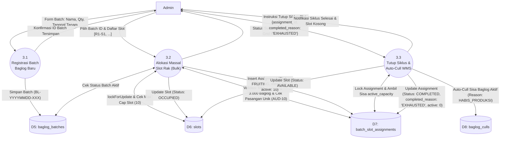
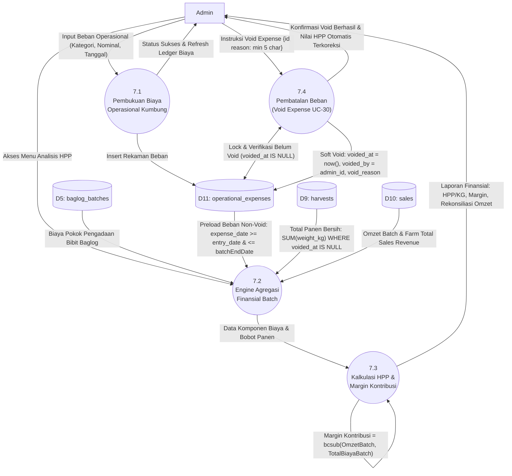

# Spesifikasi Data Flow Diagram (DFD) — Smart Shroom SCM 🍄

**Judul Tugas Akhir:** *Sistem Informasi Supply Chain Management dan Spasial WMS pada Kumbung Jamur Terintegrasi dengan Otomasi dan Monitoring Mikroklimat IoT*  
**Dokumen:** Analisis Aliran Data Sistem (Data Flow Diagram / DFD Level 0, Level 1, Level 2 & Data Dictionary)  
**Referensi Terkait:** [docs/use_case.md](file:///d:/DevTools/Antigravity/Projects/TA_vio/docs/use_case.md) | [docs/sequence_diagram.md](file:///d:/DevTools/Antigravity/Projects/TA_vio/docs/sequence_diagram.md) | [docs/erd.md](file:///d:/DevTools/Antigravity/Projects/TA_vio/docs/erd.md)  
**Penyusun:** Benedictus Vio  
**Standar Rekayasa:** Ponytail Lean Spec (Zero-Bloat, Anti-Bab 1-5 Skripsi, 100% Pure Information Flow & Data Stores)

---

## 1. Notasi & Entitas Sistem

Diagram Aliran Data (DFD) ini menggunakan notasi hibrida terstandarisasi (Gane-Sarson & Yourdon-DeMarco) yang merefleksikan arsitektur riil aplikasi:

| Komponen DFD | Simbol / Notasi | Keterangan & Representasi Sistem |
|---|---|---|
| **External Entity** (Terminator) | Kotak Persegi `[ ... ]` | Sumber data (*source*) atau tujuan akhir informasi (*sink*): Admin, Worker, IoT ESP32, Pembeli. |
| **Process** (Proses Transformasi) | Lingkaran / Rounded Box `(( ... ))` | Logika pengolahan data pada backend Laravel & frontend controller. |
| **Data Store** (Penyimpanan Data) | Silinder / Open Box `[( ... )]` | Tabel database MySQL/SQLite atau memori cache aktif. |
| **Data Flow** (Aliran Data) | Garis Panah Berarah `-->|...|` | Paket data, formulir HTTP payload, respons JSON, atau telemetri sensor. |

### Identifikasi Entitas Luar (External Entities)
1. **Admin (Pemilik Kumbung)**: Pengelola utama hak akses penuh (pengadaan batch, alokasi spasial, tutup siklus, void audit trail, threshold, HPP, registrasi).
2. **Worker (Pekerja Kumbung)**: Pelaksana harian operasional (input panen, input afkir culls, jeda panen, monitoring iklim).
3. **Perangkat IoT (ESP32)**: Aktor edge otomatis non-manusia (pengirim fusi 3x sensor SHT30 vertikal, poller threshold & command jeda, pengirim log aktuator).
4. **Pembeli / Mitra Pasar (Entitas Logistik)**: Pihak eksternal penerima pasokan jamur kuping (pedagang pasar, toko sayur, resto).

---

## 2. DFD Level 0: Diagram Konteks (Context Diagram)

Diagram konteks mendefinisikan batasan sistem (*system boundary*) secara holistik, memetakan seluruh aliran data masuk dan keluar antara entitas luar dan sistem pusat **0.0 Smart Shroom SCM**.

```mermaid
flowchart TD
    %% External Entities
    Admin["fa:fa-user-tie Admin (Pemilik Kumbung)"]
    Worker["fa:fa-user-gear Worker (Pekerja Lapangan)"]
    ESP32["fa:fa-microchip Perangkat IoT ESP32 (Edge)"]
    Buyer["fa:fa-store Pembeli / Mitra Pasar"]

    %% Core System Process
    System(("0.0<br/><b>Sistem Informasi<br/>Smart Shroom SCM</b>"))

    %% Admin Inflows
    Admin -->|"Kredensial Login, Data Akun Pekerja"| System
    Admin -->|"Konfigurasi Ambang Batas Iklim & Preset"| System
    Admin -->|"Data Pengadaan Batch Baglog Baru"| System
    Admin -->|"Perintah Alokasi Spasial Slot Rak 3D (WMS, Cap 3000)"| System
    Admin -->|"Instruksi Tutup Siklus Rak (EXHAUSTED) & Auto-Cull"| System
    Admin -->|"Instruksi Voiding Transaksi (Harvest/Sale/Cull/Expense)"| System
    Admin -->|"Data Beban Operasional Kumbung (Listrik/Air/Nutrisi/TK)"| System
    Admin -->|"Pencatatan Nota Penjualan Jamur & Opsi Force Sale Defisit"| System

    %% Admin Outflows
    System -->|"Token Sesi Sanctum, Status Autentikasi"| Admin
    System -->|"Dashboard Ringkasan 4 Kartu KPI & EWS Alert"| Admin
    System -->|"Visualisasi Denah Spasial 300 Slot & Heatmap"| Admin
    System -->|"Laporan Finansial: HPP Non-Retroaktif, Margin & Rekonsiliasi Omzet"| Admin
    System -->|"Tabel Riwayat Ledger Audit Trail (Soft Voided voided_by)"| Admin

    %% Worker Inflows
    Worker -->|"Kredensial Login"| System
    Worker -->|"Data Timbangan Panen Harian (Slot & Flush 1-7, Grade A/B/REJECT)"| System
    Worker -->|"Data Mutasi Afkir Baglog (Penyebab Rusak)"| System
    Worker -->|"Perintah Interupsi Jeda Panen (2h/4h/6h/8h)"| System
    Worker -->|"Perintah Resume ke Mode AUTO"| System

    %% Worker Outflows
    System -->|"Token Sesi, Hak Akses Operasional"| Worker
    System -->|"Status Mikroklimat Real-Time & Peringatan EWS"| Worker
    System -->|"Denah Rak Visual & Status Kapasitas Aktif"| Worker
    System -->|"Status Countdown Timer Failsafe Jeda Panen"| Worker

    %% ESP32 Inflows
    ESP32 -->|"Data Fusi Sensor Vertikal (3x SHT30 IP68)"| System
    ESP32 -->|"Log Aktivitas Aktuator (Relay Misting & Fan)"| System

    %% ESP32 Outflows
    System -->|"Konfigurasi Threshold Aktif (Temp/Humidity)"| ESP32
    System -->|"Perintah Status Mode Perangkat (PAUSE/AUTO)"| ESP32

    %% Buyer Interaction
    System -->|"Nota & Rincian Faktur Penjualan Jamur"| Buyer
    Buyer -->|"Pembayaran & Konfirmasi Pesanan"| Admin
```



---

## 3. DFD Level 1: Dekomposisi Proses Utama

DFD Level 1 memecah sistem pusat menjadi 8 subsistem fungsional terisolasi yang berinteraksi langsung dengan 11 Data Store database:

```mermaid
flowchart TD
    %% External Entities
    Admin["Admin"]
    Worker["Worker"]
    ESP32["IoT ESP32"]

    %% Data Stores
    D1[("D1: users")]
    D2[("D2: threshold_settings")]
    D3[("D3: sensor_data")]
    D4[("D4: sprinkler_logs")]
    D5[("D5: baglog_batches")]
    D6[("D6: slots")]
    D7[("D7: batch_slot_assignments")]
    D8[("D8: baglog_culls")]
    D9[("D9: harvests")]
    D10[("D10: sales")]
    D11[("D11: operational_expenses")]
    Cache[("Cache: device_command")]

    %% Process 1: Auth
    P1(("1.0<br/>Autentikasi &<br/>Manajemen Akun"))
    Admin -->|Kredensial, Registrasi| P1
    Worker -->|Kredensial| P1
    P1 <-->|Verifikasi Kredensial, Kuota Worker| D1
    P1 -->|Bearer Token, Role| Admin
    P1 -->|Bearer Token, Role| Worker

    %% Process 2: IoT Telemetry & EWS
    P2(("2.0<br/>Monitoring Iklim &<br/>EWS Engine"))
    ESP32 -->|Raw 3x SHT30 Data| P2
    P2 -->|Simpan Telemetri Fusi| D3
    D3 -->|Stream 5s Telemetri| P2
    D2 -->|Baca Batas Optimal| P2
    P2 -->|Dial Gauges, Status EWS, Grafik Riwayat| Admin
    P2 -->|Dial Gauges, Status EWS| Worker

    %% Process 3: Spasial WMS 3D
    P3(("3.0<br/>Manajemen Spasial WMS<br/>& Batch Baglog"))
    Admin -->|Batch Baru, Alokasi Slot (Cap 3000), Tutup Siklus (EXHAUSTED)| P3
    P3 <-->|Kapasitas Rak & Grid 300 Slot| D6
    P3 <-->|Relasi Alokasi Kamar Rak (Cek Pasangan Unik)| D7
    P3 <-->|Master Batch Media Tanam| D5
    P3 -->|Auto-Cull Sisa Kapasitas (HABIS_PRODUKSI)| D8
    P3 -->|Grid Interaktif, Heatmap Panen, Status Slot| Admin
    P3 -->|Denah Rak Visual & Kapasitas Aktif| Worker

    %% Process 4: Cull Ledger
    P4(("4.0<br/>Manajemen Afkir &<br/>Biosekuriti"))
    Admin -->|Alasan Void Afkir (voided_by)| P4
    Worker -->|Lapor Afkir Baglog Rusak| P4
    P4 <-->|Jurnal Mutasi Culls, Void Timestamp| D8
    P4 <-->|Decrement / Restore Active Capacity| D7
    P4 -->|Tabel Audit Afkir, Konfirmasi Restore| Admin
    P4 -->|Notifikasi Sukses Input Afkir| Worker

    %% Process 5: Harvest Multi-Flush
    P5(("5.0<br/>Pencatatan Panen<br/>Multi-Flush (<= 7)"))
    Admin -->|Alasan Void Panen (voided_by)| P5
    Worker -->|Timbangan KG, Slot, Flush 1-7, Grade A/B/REJECT| P5
    P5 <-->|Ledger Panen, Status Void, Isolasi REJECT| D9
    D7 -->|Validasi Alokasi Aktif Slot & Kapasitas| P5
    P5 -->|Grafik Tren 14 Hari, Total Hari Ini| Admin
    P5 -->|Toast Sukses, Ringkasan Harian| Worker

    %% Process 6: Supply Chain Sales
    P6(("6.0<br/>Manajemen Penjualan<br/>& Rantai Pasok"))
    Admin -->|Nota Penjualan, Bypass Force Sale, Void Sale (voided_by)| P6
    D9 -->|Akumulasi Stok Layak Jual (Grade A+B Non-Void)| P6
    P6 <-->|Jurnal Penjualan, Validasi Saldo Stok Real-Time| D10
    P6 -->|Tabel Penjualan, Tag [FORCE SALE], Omzet| Admin

    %% Process 7: Costing & Dynamic COGS
    P7(("7.0<br/>Akuntansi Biaya &<br/>HPP Dinamis (UC-30)"))
    Admin -->|Input Beban Operasional, Void Expense (voided_by)| P7
    P7 <-->|Buku Beban Operasional (Scope withoutVoided)| D11
    D5 -->|Biaya Pokok Pengadaan Bibit Batch| P7
    D9 -->|Total Bobot Panen Bersih Non-Void| P7
    D10 -->|Omzet Batch & Rekonsiliasi Omzet Farm| P7
    P7 -->|Metrik HPP/KG Non-Retroaktif, Margin Laba, Audit Void| Admin

    %% Process 8: Failsafe Actuator
    P8(("8.0<br/>Kontrol Interupsi &<br/>Edge Actuator"))
    Admin -->|Update Threshold, Jeda Panen| P8
    Worker -->|Jeda Panen / Resume AUTO| P8
    P8 <-->|Put / Get Status Mode Jeda| Cache
    P8 <-->|Simpan Ambang Batas Aktif| D2
    ESP32 <-->|Polling Threshold & Command| P8
    ESP32 -->|Log Status Pompa/Kipas| P8
    P8 -->|Catat Riwayat Eksekusi Relay| D4
    P8 -->|Countdown Timer UI, Status Mode| Admin
    P8 -->|Countdown Timer UI, Status Mode| Worker
```

---

## 4. DFD Level 2: Dekomposisi Proses Kritis

### 4.1 DFD Level 2 — Proses 3.0: Manajemen Spasial WMS & Siklus Rak (UC-08, UC-19, UC-29)
Membedah interaksi kompleks alokasi kamar rak 3D, verifikasi hard cap 3.000 baglog, kunci atomik kapasitas, dan penutupan siklus panen.



---

### 4.2 DFD Level 2 — Proses 7.0: Akuntansi Biaya Manajerial & HPP Dinamis (UC-22, UC-23, UC-30)
Membedah kalkulasi Harga Pokok Produksi dinamis non-retroaktif, presisi moneter `bcmath`, dan audit pembatalan pengeluaran operasional (*soft void*).



---

## 5. Kamus Data Aliran Informasi (Data Dictionary)

Spesifikasi struktur data pada arus informasi utama sistem yang selaras dengan skema database dan validasi request:

| Arus Data | Sumber & Tujuan | Format & Struktur Atribut |
|---|---|---|
| `TelemetriSensor` | ESP32 $\rightarrow$ P2.0 $\rightarrow$ `sensor_data` | `{temp_top: Float, temp_mid: Float, temp_bottom: Float, humidity_avg: Float, heat_index: Float, created_at: Timestamp}` |
| `BatasThreshold` | Admin $\rightarrow$ P8.0 $\rightarrow$ `threshold_settings` | `{temp_min: Float, temp_max: Float, humidity_min: Float, humidity_max: Float, phase_preset: String}` *(Syarat: `humidity_max - humidity_min >= 4`)* |
| `CommandJeda` | User $\rightarrow$ P8.0 $\rightarrow$ `Cache` $\rightarrow$ ESP32 | `{command: Enum('AUTO','PAUSE'), duration_seconds: Int, expires_at: Timestamp}` |
| `AlokasiSlot` | Admin $\rightarrow$ P3.2 $\rightarrow$ `batch_slot_assignments` | `{baglog_batch_id: Int, assigned_at: Date, slots: Array<{slot_code: String, initial_quantity: Int, initial_mycelium_stage: Enum}>}` *(Validasi: Kapasitas kumbung $\le 3.000$ baglog, pasangan batch-slot belum aktif)* |
| `TutupSiklusRequest` | Admin $\rightarrow$ P3.3 $\rightarrow$ `batch_slot_assignments` | `{assignment_id: Int, completed_reason: Enum('EXHAUSTED','DISCARDED','FAILED')}` |
| `JurnalAfkir` | User $\rightarrow$ P4.0 $\rightarrow$ `baglog_culls` | `{slot_code: String, quantity: Int, reason: Enum('TRICHODERMA','CONTAMINATED','DRIED','HABIS_PRODUKSI'), notes: String}` |
| `VoidRequest` | Admin $\rightarrow$ P4.0 / P5.0 / P6.0 / P7.4 | `{id: Int, reason: String(min: 5), voided_by: Int, voided_at: Timestamp}` *(Berlaku seragam untuk Cull, Harvest, Sale, dan Expense)* |
| `DataPanen` | Worker $\rightarrow$ P5.0 $\rightarrow$ `harvests` | `{slot_code: Nullable<String>, baglog_batch_id: Nullable<Int>, flush_number: Int(1-7), weight_kg: Decimal(8,2), quality_grade: Enum('A','B','REJECT'), harvest_date: Date}` *(Grade REJECT diisolasi dari stok jual)* |
| `NotaPenjualan` | Admin $\rightarrow$ P6.0 $\rightarrow$ `sales` | `{buyer_name: String, quantity_kg: Decimal(8,2), price_per_kg: Decimal(12,2), payment_method: String, total_revenue: Decimal(12,2), force: Boolean, force_reason: Nullable<String>}` *(Wajib lolos saldo stok riil kecuali force: true)* |
| `BebanOperasional` | Admin $\rightarrow$ P7.1 $\rightarrow$ `operational_expenses` | `{baglog_batch_id: Nullable<Int>, expense_date: Date, category: Enum('LISTRIK','AIR','NUTRISI','LABOR','PACKAGING','LAINNYA'), amount: Decimal(12,2), notes: Nullable<String>, voided_at: Nullable<Timestamp>, voided_by: Nullable<Int>, void_reason: Nullable<String>}` |
| `RingkasanHPP` | P7.3 $\rightarrow$ Admin UI | `{batch_id: Int, procurement_cost: Decimal, allocated_overhead: Decimal, total_cost: Decimal, net_harvest_kg: Decimal, hpp_per_kg: Decimal, contribution_margin: Decimal, farm_total_sales_revenue: Decimal, unattributed_sales_revenue: Decimal}` |

---

## 6. Matriks Relasi DFD vs Use Case vs Data Store

Traceability menyeluruh untuk menjamin validitas rekayasa perangkat lunak tanpa celah fungsional (*zero orphaned use case*):

| ID DFD | Nama Proses DFD | Kode Use Case Terkait | Data Store yang Terlibat |
|---|---|---|---|
| **1.0** | Autentikasi & Akun | UC-01, UC-02, UC-03 | `D1: users` |
| **2.0** | Monitoring Iklim & EWS | UC-04, UC-05, UC-06 | `D2: threshold_settings`, `D3: sensor_data` |
| **3.0** | Spasial WMS 3D & Siklus | UC-08, UC-09, UC-10, UC-19, UC-20, UC-29 | `D5: baglog_batches`, `D6: slots`, `D7: batch_slot_assignments`, `D8: baglog_culls` |
| **4.0** | Mutasi Afkir & Biosekuriti | UC-21, UC-28 | `D7: batch_slot_assignments`, `D8: baglog_culls` |
| **5.0** | Pencatatan Panen Multi-Flush | UC-11, UC-12, UC-14, UC-26 | `D7: batch_slot_assignments`, `D9: harvests` |
| **6.0** | Manajemen Penjualan & Rantai Pasok | UC-13, UC-27 | `D9: harvests`, `D10: sales` |
| **7.0** | Akuntansi HPP Dinamis & Beban | UC-22, UC-23, UC-30 | `D5: baglog_batches`, `D9: harvests`, `D10: sales`, `D11: operational_expenses` |
| **8.0** | Kontrol Failsafe & Aktuator | UC-07, UC-15, UC-16, UC-17, UC-18, UC-24, UC-25 | `D2: threshold_settings`, `D4: sprinkler_logs`, `Cache: device_command` |
