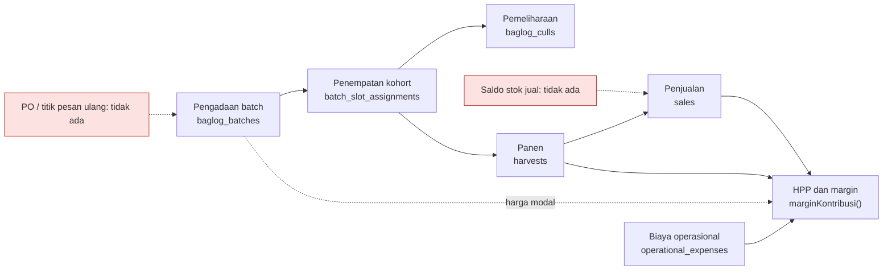

# Laporan Audit WMS & SCM — Smart Shroom SCM

| Atribut | Keterangan |
|---|---|
| Objek audit | Pilar 2: *Warehouse Management System* (WMS) dan *Supply Chain Management* (SCM) — backend Laravel, frontend React, dokumen rujukan |
| Basis | Repositori `Kaz0342/TA`, cabang `develop`, commit `3b17f60` |
| Tanggal | 10 Oktober 2026 |
| Metode | Pembacaan kode baris demi baris; eksekusi suite tes repositori; 26 probe perilaku observasional; simulasi logika tanggal frontend (Node) |
| Prinsip kerja | Logika dulu, kesesuaian dokumen kemudian. Tidak ada berkas repositori yang diubah |
| Dokumen terkait | `ANALISIS_ALUR_BAGLOG_WMS.md` (temuan W-01…W-17, basis `8187915`), `docs/logika-bisnis/SANITY_CHECK_ANALISIS_WMS.md` (lima keputusan pemilik budidaya) |

**Daftar isi:** 0 Ringkasan Eksekutif · 1 Ruang Lingkup, Metode, Keterbatasan · 2 Gambaran Sistem (*As-Is*) · 3 Kepatuhan Keputusan Pemilik dan Kapasitas · 4 Status W-01…W-17 · 5 Temuan Baru (AUD-01…AUD-17) · 6 Kesenjangan SCM · 7 Klaim Dokumen vs Kode · 8 Rencana Perbaikan · 9 Keputusan yang Diperlukan · Lampiran A–D

---

## 0. Ringkasan Eksekutif

**Kesimpulan.** Kerangka WMS sudah layak: pelacakan kohort per slot, ledger afkir, pola *void*, penutupan siklus otomatis, dan agregasi anti-N+1 pada `/slots` bekerja dan seluruh suite tes repositori lulus (176 tes, 632 asersi). Namun audit perilaku menemukan **17 temuan baru** di atas kondisi lulus-tes tersebut: 5 berperingkat Tinggi, 8 Sedang, dan 4 Rendah. Sebagian besar muncul karena dua jalur baru yang belum mengikuti mesin siklus hidup (penimbangan per batch dan penutupan lewat jurnal afkir), serta karena kontrol akses hanya ditegakkan di antarmuka.

**Status keputusan pemilik.** Satu keputusan terpenuhi penuh (#5 kohort), tiga terpenuhi sebagian (#1, #2, #4), satu belum diimplementasikan (#3, bersifat opsional). Batas kapasitas **3.000 baglog belum ditegakkan** oleh sistem: penambahan rak tidak dibatasi dan terbukti menaikkan kapasitas menjadi 5.000.

**Status temuan lama.** Dari W-01…W-17: 6 tertutup, 8 tertutup sebagian, 3 masih terbuka (W-14, W-16, W-17).

| Peringkat | Jumlah | Makna |
|---|:---:|---|
| Tinggi | 5 | Merusak integritas data atau keuangan, atau melanggar kontrol akses / keputusan pemilik pada alur utama. Perlu beres sebelum sidang atau pemakaian nyata |
| Sedang | 8 | KPI menyesatkan atau kerapuhan operasional yang muncul pada kondisi realistis |
| Rendah | 4 | Celah kecil, kasus tepi, utang teknis |

**Lima temuan Tinggi (rinci di Bagian 5):**

1. **AUD-01** — Pekerja (*worker*) dapat mengubah status batch (termasuk memusnahkan seluruh batch dan menutup semua slotnya), membatalkan (*void*) catatan afkir, dan membaca data keuangan. Pembatas hanya ada di antarmuka, bukan di server.
2. **AUD-02** — Penjualan tidak divalidasi terhadap stok. Penjualan 500 kg dengan panen 0 kg diterima; laporan mingguan menampilkan sisa 0 kg sehingga label "Defisit" di antarmuka tidak pernah muncul. Klaim katalog L-47 ("memvalidasi ketersediaan stok dan memotong stok") tidak sesuai kode. Ini adalah W-17 yang tidak pernah dikerjakan.
3. **AUD-03** — Mode timbang per batch (Keputusan #1) melewati mesin siklus hidup: slot tetap `INCUBATION`, tidak ada batas flush, lencana status, peringatan PO, dan peta panas per slot tidak hidup.
4. **AUD-04** — Status batch dan status penempatan tidak konsisten di lima jalur penutupan/pembukaan siklus (batch `completed` dengan slot aktif, slot dengan kapasitas hantu, batch yang bisa "dihidupkan kembali" dari `disposed`).
5. **AUD-05** — Tanggal dikirim backend sebagai ISO-UTC sedangkan frontend memotongnya sebagai string. Tanggal bawaan formulir salah satu hari pada 00:00–07:00 WIB (jam panen pagi), dan KPI "panen hari ini" menampilkan 0 pada 07:00–24:00 WIB.

**Yang sudah baik (agar adil):** kunci pesimistik pada penempatan dan afkir (`lockForUpdate`), rekonsiliasi jumlah penempatan terhadap kuantitas batch, matriks transisi status penempatan, kode batch dengan percobaan ulang saat bentrok, agregasi 5 query untuk 300 slot di `/slots`, *global scope* `notVoided` yang konsisten pada agregat panen/penjualan/afkir, dan bendera `price_missing` pada HPP.

**Keputusan yang diminta dari Anda** (Bagian 9): definisi "flush" pada mode timbang per batch; apakah pekerja boleh membatalkan panen; stok jual: blokir atau peringatkan; perlakuan panen `REJECT`; cara menegakkan 3.000 baglog; dan cakupan SCM yang akan diklaim di TA.

---

## 1. Ruang Lingkup, Metode, dan Keterbatasan

### 1.1 Ruang lingkup

Termasuk: model `baglog_batches`, `slots`, `batch_slot_assignments`, `baglog_culls`, `harvests`, `sales`, `operational_expenses`; layanan, pengendali, rute, migrasi terkait; halaman `BaglogManagement`, `KumbungGrid`, `HarvestManagement`, `SalesManagement`, komponen modal slot/afkir/rak; dokumen PRD, ERD, use case, katalog logika.

Tidak termasuk: pilar 1 (IoT dan perangkat keras), kecuali dicatat di Lampiran D.

### 1.2 Metode

| Langkah | Hasil |
|---|---|
| Suite tes repositori dijalankan di salinan kerja (PHP 8.3, SQLite *in-memory*) | 176 lulus, 632 asersi |
| 26 probe perilaku (`AuditProbeWmsTest.php`) merekam keluaran nyata kode ke JSON, tanpa menilai benar/salah | Seluruh angka pada laporan ini diambil dari rekaman tersebut dan ditandai dengan ID probe (P01, P02, …) |
| Simulasi Node untuk logika tanggal frontend (`toISOString().split('T')[0]`, `startsWith`) terhadap keluaran tanggal backend | Mengonfirmasi AUD-05 |
| Pembacaan statis kode (backend dan frontend) | Rujukan `berkas:baris` pada tiap temuan |

### 1.3 Keterbatasan (dinyatakan terbuka)

- Probe berjalan pada **SQLite**, sedangkan produksi memakai Postgres (Supabase). Hasil logika sama; perilaku kunci (*locking*) dan konkurensi tidak diuji (lihat AUD-16).
- Antarmuka **tidak dijalankan di peramban**. Klaim sisi frontend bersumber dari pembacaan kode dan simulasi Node, dan ditandai "UI" terpisah dari klaim "API".
- Tidak ada uji beban. Jumlah query dihitung pada data kecil (10–40 baris) dan diekstrapolasi linear (AUD-08).
- Estimasi effort pada Bagian 8 adalah perkiraan penyusun, bukan hasil pengukuran.
- Pada 26 probe, penomoran tidak berurutan (P12/P13 digabung; beberapa nomor dilewati) karena probe yang digabung atau tidak diperlukan.

---

## 2. Gambaran Sistem Saat Ini (*As-Is*)

### 2.1 Rantai data

Ciri desain yang relevan:

- **Kohort, bukan individu** (Keputusan #5). Satu baris `batch_slot_assignments` = satu kelompok baglog (maks. 10 per slot) pada satu slot. Kapasitas hidup = `initial_quantity` − jumlah afkir tidak ter-*void* untuk pasangan (batch, slot) (`BatchSlotAssignment.php:149-158`).
- **Ledger berkunci (batch, slot)**, bukan `assignment_id`. Afkir dan panen merujuk `baglog_batch_id` + `slot_code`. Konsekuensinya diuraikan pada AUD-10.
- **Void**: *trait* `HasVoid` memasang *global scope* `notVoided` (`app/Traits/HasVoid.php:20-25`) pada panen, penjualan, dan afkir. Batch, penempatan, dan biaya operasional tidak memiliki *void*.
- **Kapasitas** diturunkan dari baris slot (`Slot::sum('max_capacity')`), bukan dari konstanta atau batasan basis data. Penyemaian awal: 3 rak × 100 slot × 10 baglog = 3.000 (`database/seeders/SlotSeeder.php:9-16`).
- **Zona waktu aplikasi** `Asia/Jakarta` (`config/app.php:68`); kolom tanggal memakai *cast* `date` (`Harvest.php:64`, `Sale.php:70`, `OperationalExpense.php:49`, `BaglogBatch.php:76`).

### 2.2 Mesin siklus hidup

Status penempatan: `INCUBATION → FRUITING → COMPLETED` (matriks `BatchSlotAssignment.php:39-43`). Status batch: `active`, `completed`, `contaminated`, `disposed` (`BaglogBatch.php:48-54`). Batch seharusnya diturunkan dari penempatan, tetapi hanya sebagian jalur yang menyegarkannya:

| Jalur | Pemicu | Penempatan | Jurnal afkir | Batch disegarkan? | *Void* afkir membuka kembali? |
|---|---|---|---|---|---|
| 1. Tombol "Tutup Siklus" | `POST /batch-slot-assignments/{id}/complete` (`BatchSlotAssignmentController.php:184-215`) | `COMPLETED`, alasan `EXHAUSTED` | sisa → `HABIS_PRODUKSI` | Ya (`BatchSlotAssignment.php:211`) | Ya, tetapi **batch tidak ikut dibuka** (`BaglogCullController.php:186-199`) |
| 2. Afkir hingga kapasitas 0 | `POST /baglog-culls` | `COMPLETED`, `EXHAUSTED` (`BaglogCullController.php:126-133`) | afkir itu sendiri | **Tidak** | Ya, sama seperti jalur 1 |
| 3. Tutup manual | `PATCH /batch-slot-assignments/{id}/status` dengan `reason=MANUAL` (`:136-177`) | `COMPLETED`, `MANUAL` | sisa → `HABIS_PRODUKSI` (`BatchSlotAssignment.php:192`) | Ya | **Tidak** (hanya `EXHAUSTED`) → kapasitas hantu |
| 4. Batch `contaminated`/`disposed` | `PATCH /baglogs/{id}/status` (`BaglogService.php:39-59`) | `COMPLETED`, alasan sesuai | sisa → `LAINNYA` | Ya | Tidak |
| 5. Batch `completed` manual | `PATCH /baglogs/{id}/status` | **tidak berubah** | tidak ada | — | — |

Tabel ini adalah inti AUD-04.

---

## 3. Kepatuhan terhadap Keputusan Pemilik dan Batas Kapasitas

Sumber keputusan: `docs/logika-bisnis/SANITY_CHECK_ANALISIS_WMS.md` §6. Kapasitas 3.000 baglog: keputusan Anda pada 8 Oktober 2026.

| # | Keputusan | Status | Bukti | Keterangan |
|---|---|---|---|---|
| 1 | Panen ditimbang **per batch**; `slot_code` opsional | **Sebagian** | UI: `HarvestManagement.tsx:307,321-323,1082-1150`. API: `HarvestService.php:90-102` | Input diterima, tetapi turunannya tidak hidup (AUD-03; P11, P28) |
| 2 | Akhir hidup **hibrida**: flush 5 peringatan; flush 7 *prompt* "Tutup siklus?"; kapasitas 0 tutup otomatis; tombol tutup manual | **Sebagian** | Peringatan flush 5: `BatchSlotAssignment.php:252-261`. Flush 7: tidak ada *prompt*; mode slot menolak flush ke-8 (`HarvestService.php:80`); ambang "Tua" ada di flush **6** (`config/baglog.php:11-14`). Tutup otomatis: `BaglogCullController.php:126-133`. Tombol: `SlotDetailModal.tsx:174-205` | Jalur otomatis tidak menyegarkan batch (AUD-04). Pada mode batch tidak ada batas maupun lencana (AUD-03) |
| 3 | Reject saat datang **dikurangi di awal**; tambah `rejected_quantity` (opsional) | **Belum** | Tidak ada kolom/validasi `rejected_quantity` di migrasi, model, atau formulir | `quantity` batch tidak dikaitkan dengan "jumlah yang masuk rak" |
| 4 | `entry_date` = tanggal datang; `initial_mycelium_stage` sebagai **offset** umur | **Sebagian** | `entry_date` dipakai untuk umur dan kode batch (`BaglogBatch.php:100-103,289-306`). Tahap miselium tidak dipakai (`BatchSlotAssignment.php:223-328`) | Dua "jam umur" berbeda: batch (`entry_date`) dan slot (`assigned_at`) (AUD-11) |
| 5 | **Kohort** per slot | **Sesuai** | Ledger berkunci (batch, slot) | Dengan catatan kunci ledger (AUD-10) |
| — | Kapasitas **3.000 baglog** | **Belum ditegakkan** | `SlotController.php:295-360` tidak membatasi; P14: dua rak tambahan → 5.000. Konstanta 3000/300 tersebar di `DashboardService.php:80-81`, `BaglogManagement.tsx:129`, `Dashboard.tsx:283` | AUD-09; dokumen L-38/L-40 menyatakan kapasitas dinamis, bertentangan dengan keputusan |

---

## 4. Status Temuan Lama (W-01 … W-17) pada Commit `3b17f60`

Definisi asli: `ANALISIS_ALUR_BAGLOG_WMS.md` (basis `8187915`). Hasil: **6 tertutup, 8 sebagian, 3 terbuka**.

Catatan versi: salinan di `docs/` (revisi 1 Oktober) dan salinan koreksi (2 Oktober) berbeda pada redaksi W-13 (fallback `3000` versus aturan harga UI ≠ API). Pada commit `8187915` keduanya memang ada (`BaglogManagement.tsx:234` dan `:898`); pada `3b17f60` keduanya sudah tidak ada, jadi status W-13 sama untuk kedua redaksi.

| ID | Temuan lama (ringkas) | Status | Bukti saat ini | Residu / catatan |
|---|---|---|---|---|
| W-01 | Formulir panen tidak mengirim slot, flush, grade | **Tertutup** | UI mengirim ketiganya (`HarvestManagement.tsx:321-323`); API memvalidasi slot–batch (`HarvestService.php:40-56`) | Jalur mode batch: AUD-03 |
| W-02 | Tidak ada akhir siklus | **Sebagian** | `complete()` (`BatchSlotAssignment.php:181-213`), tombol (`SlotDetailModal.tsx:174-205`), tutup otomatis kapasitas 0 (`BaglogCullController.php:126-133`) | Lima jalur tidak seragam: AUD-04 |
| W-03 | KPI "Baglog Aktif" tidak mengikuti siklus | **Tertutup** | Batch aktif dikurangi afkir (`DashboardService.php:33-36`) | Baglog belum ditempatkan terhitung aktif: AUD-13 |
| W-04 | Penempatan tanpa rekonsiliasi jumlah batch | **Tertutup** | `BatchSlotAssignmentController.php:80-91` | UI memaku 10/slot (AUD-13); P19 |
| W-05 | Model umur tidak konsisten, abaikan tahap miselium | **Sebagian** | Ambang di `config/baglog.php`; lencana berbasis flush nyata (`BatchSlotAssignment.php:233-283`) | Miselium tidak dipakai; ambang dikeraskan di UI (AUD-11, AUD-15) |
| W-06 | Kontrak lencana UI↔backend | **Tertutup** | Backend mengirim `dot` dan `class` (`BatchSlotAssignment.php:243-245`); `total_harvest_kg`, `last_flush` terkirim (`SlotController.php:116-117`) | — |
| W-07 | Lima celah pencatatan afkir | **Sebagian** | (a) reject saat datang: belum. (b) `HABIS_PRODUKSI` ada (`BaglogCullController.php:73`) tetapi belum dipisah dari mortalitas. (c) tanggal ≤ hari ini dan ≥ `assigned_at` (`:71,98-104`). (d) transaksi + `lockForUpdate` (`:86-92`). (e) modal terbuka dari slot, `max` mengikuti kapasitas (`RecordCullModal.tsx:18,27,196`; `KumbungGrid.tsx:871`) | (a): Keputusan #3; (b): AUD-06 |
| W-08 | Validasi backend panen minimal | **Sebagian** | Kecocokan slot–batch, slot kosong, auto-flush, batas tanggal (`HarvestService.php:40-78`; `StoreHarvestRequest.php:29`) | Belum: idempotensi dan kewajaran berat (P11), `REJECT` masih dihitung (AUD-12) |
| W-09 | Tidak ada koreksi | **Sebagian** | *Void* panen, penjualan, afkir (`HasVoid.php`; `api.php:64,83,124`) | Biaya dihapus permanen (`OperationalExpenseController.php:76-87`; P21); batch dan penempatan tanpa *void* |
| W-10 | Transisi status bebas | **Sebagian** | Matriks transisi penempatan (`BatchSlotAssignmentController.php:162-166`); kaskade `contaminated/disposed` (`BaglogService.php:49-55`) | Status batch tanpa penjaga (P18): AUD-04 |
| W-11 | Validasi tanggal tidak ada | **Sebagian** | Jalur slot lengkap (`HarvestService.php:66`; `BaglogCullController.php:98-104`; `BatchSlotAssignmentController.php:30,75-78`) | Belum: panen mode batch (P12), `entry_date`/penjualan/biaya masa depan, tutup siklus mundur (P20): AUD-14 |
| W-12 | Kode batch: tanggal dan *race* | **Tertutup** | Prefiks dari `entry_date` (`BaglogBatch.php:289-306`); percobaan ulang 3× (`BaglogRepository.php:31-48`) | — |
| W-13 | Harga modal bisa salah diam-diam; aturan harga UI tidak sama dengan API | **Tertutup** | Fallback `3000` dan syarat `min="500"` di UI sudah tidak ada; harga kosong dikirim `0` (`BaglogManagement.tsx:303`); backend menandai `price_missing` bila `null` atau ≤ 0 (`BaglogBatch.php:378`); kartu HPP menampilkan peringatan (`HppAnalysisCard.tsx:222-232`) | Residu kecil: kolom bertanda wajib sudah terisi `0` secara bawaan (`BaglogManagement.tsx:72`), sehingga batch tanpa harga tetap bisa disimpan dan baru ditandai di kartu HPP; validator tetap `nullable\|min:0` (`StoreBaglogRequest.php:23`). Diterima sebagai desain |
| W-14 | Overhead dibagi rata ke semua batch | **Terbuka** (diterima sebagai batasan desain) | `BaglogBatch.php:329-334` | P22 memperlihatkan dampak retroaktif: AUD-07 |
| W-15 | N+1 pada `/slots` | **Sebagian** | `/slots` kini 5 query untuk 300 slot (`SlotController.php:42-72`; P08) | Muncul kembali lewat `$appends` di `/harvests`, `/baglogs/hpp-summary`, dasbor: AUD-08 |
| W-16 | Heatmap kg mentah | **Terbuka** (sebagian) | *Void* dikecualikan (`SlotController.php:208`); dinormalisasi ke maksimum (`:220-224`) | Tetap kg mentah, seluruh waktu, semua batch, termasuk `REJECT` |
| W-17 | Penjualan tanpa validasi stok | **Terbuka** | `SaleService.php:22-30,60`; `StoreSaleRequest.php:19-27` | AUD-02, AUD-12 |

Catatan: dokumen `SANITY_CHECK_ANALISIS_WMS.md` menyusun Fase A–D tanpa memuat W-16 dan W-17; keduanya memang tidak pernah dijadwalkan.

---

## 5. Temuan Baru Berperingkat

Format tiap temuan: **Lokasi** (berkas:baris), **Bukti** (ID probe atau pembacaan kode), **Skenario kegagalan**, **Rekomendasi**. Estimasi effort ada di Bagian 8.

### Peringkat Tinggi

#### AUD-01 — Kontrol akses tidak ditegakkan di server

- **Lokasi.** `routes/api.php:59` (ubah status batch), `:64` (void panen), `:83` (void afkir) berada di luar grup `role:admin` (`:97-125`). Pembacaan data keuangan juga di luar grup: `:69-72` (penjualan, laporan mingguan), `:86-87` (HPP), `:90` (biaya operasional). Antarmuka menyembunyikan tombol dari pekerja (`BaglogManagement.tsx:381,704,788,867`; `SalesManagement.tsx:110,120,129`), tetapi server tidak menolak.
- **Bukti.** P01: pekerja memanggil `PATCH /baglogs/{id}/status` = `disposed` → HTTP 200; dua slot batch menjadi `COMPLETED` dan 20 baglog sehat tercatat sebagai afkir `LAINNYA`. P02: pekerja memperoleh 200 pada void panen, void afkir, `GET /baglogs/hpp-summary`, `GET /sales`, `GET /operational-expenses`; sedangkan void penjualan, tambah batch, tambah penempatan, dan tambah rak = 403.
- **Skenario.** Salah satu dari lima akun pekerja (kuota pada `use_case.md` UC-02) yang salah klik atau disalahgunakan dapat memusnahkan batch 1.500 baglog lewat satu permintaan: seluruh kohort ditutup, jurnal afkir terisi, KPI berubah; pemulihannya pun hanya lewat `PATCH` status `active` yang tanpa penjaga (AUD-04). Pekerja juga dapat melihat harga jual, margin, dan HPP, padahal matriks hak akses (`use_case.md` UC-09, 13, 14, 22, 23, 26, 28) menyatakan itu hak admin.
- **Catatan dokumen.** PRD §9 menyatakan void panen boleh Worker/Admin; use case UC-26 menyatakan Admin saja. Perlu keputusan (D-2).
- **Rekomendasi.** Pindahkan `PATCH /baglogs/{id}/status`, `POST /baglog-culls/{id}/void`, dan semua `GET` keuangan ke grup `role:admin`. Void panen mengikuti D-2 (admin saja, atau pekerja terbatas pada rekaman miliknya dalam 24 jam). Tambahkan tes tabel-hak-akses: tiap rute pada matriks UC diuji 403 untuk pekerja.

#### AUD-02 — Penjualan tanpa validasi stok (W-17 tidak pernah dikerjakan)

- **Lokasi.** `SaleService.php:22-30` (tanpa pemeriksaan); `StoreSaleRequest.php:19-27` (`quantity_kg` hanya `min:0.1`, `baglog_batch_id` opsional, tanggal tanpa batas); `SaleService.php:60` (`max(0, …)`); `SalesManagement.tsx:792-803` ("Sisa Stok Panen (Buffer)" dengan label "Defisit" yang tidak terjangkau).
- **Bukti.** P09: panen di basis data 0 kg; `POST /sales` 500 kg → 201; penjualan bertanggal masa depan → 201; laporan mingguan: `total_sales_kg` 500, `unsold_kg` 0.
- **Skenario.** Salah ketik 500 untuk 5,0 kg lolos tanpa peringatan; omzet, HPP per kg, dan margin ikut terdistorsi, dan "Defisit" tidak pernah tampil sehingga selisih tersembunyi. Laporan mingguan juga tidak membawa saldo antar pekan (stok bergulir) dan menghitung panen `REJECT` (AUD-12).
- **Dokumen.** Katalog L-47 dan UC-14 menyatakan sistem memvalidasi serta memotong stok. Tidak ada kode yang melakukannya, sehingga klaim itu tidak dapat dipertahankan saat sidang tanpa perbaikan.
- **Rekomendasi.** Definisikan *stok jual* = Σ panen layak jual (bukan `REJECT`, tidak *void*) sampai tanggal penjualan − Σ penjualan tidak *void* sampai tanggal itu. Tolak (422) penjualan yang melampaui stok, atau izinkan dengan penanda `force` + alasan (D-3). Batasi `sale_date ≤ today`. Laporan mingguan menampilkan nilai negatif apa adanya dan menambahkan saldo awal pekan. Karena jamur kuping segar cepat rusak, jendela stok dapat dibatasi (mis. 2–3 hari) — butuh masukan pemilik budidaya.

#### AUD-03 — Mode timbang per batch melewati mesin siklus hidup

- **Lokasi.** `HarvestService.php:90-102` (cabang batch: tanpa transisi status, tanpa batas flush, tanpa pemeriksaan tanggal). Transisi `INCUBATION→FRUITING` otomatis hanya ada di cabang slot (`:87-89`). Lencana membaca flush per (batch, slot) (`SlotController.php:63,115`; `BatchSlotAssignment.php:223-240`). Tidak ada jalur UI untuk transisi manual: `slotService.ts:99` (`updateStatus`) tidak dipanggil dari mana pun.
- **Bukti.** P11: sepuluh panen mode batch → flush 1…10 diterima tanpa penolakan, penempatan tetap `INCUBATION`; mode slot menolak panen ke-8 ("Melebihi batas flush maksimal (7); silakan tutup siklus slot ini."). P28: enam panen tingkat batch (flush 1–6), tiga slot tetap berlabel "H+60 • Masa Produktif", `flush` 0, `needs_po_alert` false; `heatmap_max_kg` hanya 1 (tidak ada data per slot).
- **Skenario.** Pemilik menimbang per batch setiap hari (cara kerja yang diputuskan). Setelah lima hari timbang, penghitung "flush" sudah 5 padahal itu masih satu gelombang panen biologis; di sisi lain lencana, peringatan PO, dan *prompt* "Tutup siklus?" (Keputusan #2) tidak pernah menyala, dan peta panas kosong. Keputusan #1 dan #2 saling meniadakan pada implementasi sekarang.
- **Rekomendasi.** (i) Tetapkan arti flush pada mode batch (D-1); disarankan *gelombang panen* yang diinput admin (1–7), atau naik otomatis bila jeda sejak panen terakhir ≥ N hari. (ii) Turunkan lencana kohort dari flush maksimum **tingkat batch** bila slot tidak punya panen sendiri, dengan batas 7 dan *prompt* yang sama. (iii) Cabang batch memeriksa `harvest_date ≥ entry_date` dan menaikkan penempatan batch itu ke `FRUITING`. (iv) Peta panas menampilkan "tidak ada data per slot", bukan skala 1 kg.

#### AUD-04 — Siklus hidup batch dan penempatan tidak konsisten

- **Lokasi.** Tabel §2.2; `BaglogCullController.php:126-133`, `:186-199`; `BaglogService.php:39-59`; `BaglogBatch.php:262-274`; `BatchSlotAssignment.php:188-193`.
- **Bukti.**
  - P03: tutup lewat afkir sampai 0 → penempatan `COMPLETED`, batch tetap `active`; tutup lewat tombol → batch `completed`.
  - P04: setelah tutup lewat tombol lalu *void* afkir `HABIS_PRODUKSI`, penempatan kembali `FRUITING` berkapasitas 10 tetapi batch tetap `completed`; panen mode batch → 422 ("Batch baglog tidak aktif"), panen mode slot → 201, dasbor `active_baglogs` = 0 padahal 10 baglog hidup.
  - P05: tutup `MANUAL` mencatat afkir bertipe `HABIS_PRODUKSI`; *void* afkir itu membuat kapasitas kembali 10 tetapi penempatan tetap `COMPLETED` (kapasitas hantu), slot lalu dapat dipakai lagi (201) sehingga ada dua penempatan pada satu slot.
  - P18: batch ditandai `completed` sementara slot tetap `INCUBATION`; `disposed → active` diterima (200) dengan slot `COMPLETED`, dan penempatan baru dari batch itu diterima (201).
  - P19: batch 100 baglog, 10 ditempatkan, slot itu ditutup → batch otomatis `completed` dengan 90 baglog belum ditempatkan; penempatan lanjutan 422 "Batch baglog sudah tidak aktif." (`refreshLifecycle` mengabaikan sisa yang belum ditempatkan, `BaglogBatch.php:268-272`).
- **Skenario.** Mengafkir baglog sampai habis di semua slot membuat batch "aktif" selamanya pada dasbor; sebaliknya, salah-void membuat batch "selesai" padahal masih ada baglog hidup di rak yang tidak lagi terhitung.
- **Rekomendasi.** Satu fungsi `BaglogBatch::syncLifecycle()` yang menurunkan status batch dari penempatan (bukan sebaliknya) dan dipanggil semua jalur (simpan afkir, void afkir, tutup siklus, hapus penempatan). `changeStatus` hanya mengizinkan `active → contaminated|disposed`; `completed` otomatis; tolak `* → active`. *Void* afkir membuka kembali penempatan untuk semua alasan otomatis dan menyegarkan batch dua arah. Batch dengan sisa belum ditempatkan tidak otomatis `completed`. Alasan `MANUAL` tidak dipetakan ke `HABIS_PRODUKSI` (lihat AUD-06).

#### AUD-05 — Tanggal ISO-UTC dari backend bertemu logika string di frontend

- **Lokasi.** Backend: *cast* `date` (`Harvest.php:64`, `Sale.php:70`, `OperationalExpense.php:49`, `BaglogBatch.php:76`) diserialisasi langsung pada `/harvests`, `/sales`, `/operational-expenses`, `/baglogs`. Frontend: pola `new Date().toISOString().split('T')[0]` muncul 14 kali sebagai tanggal bawaan (mis. `HarvestManagement.tsx:81,283`, `KumbungGrid.tsx:52`, `BaglogManagement.tsx:70,256`, `SalesManagement.tsx:90,190`); `startsWith(todayStr)` pada `HarvestManagement.tsx:141-142,183-184`.
- **Bukti.** P25: pada tanggal WIB 2026-10-09, `harvest_date` dan `entry_date` terkirim `2026-10-08T17:00:00.000000Z`. Simulasi Node: pada 00:00–07:00 WIB tanggal bawaan formulir = kemarin; pada 07:00–24:00 WIB `startsWith(todayStr)` tidak cocok sehingga "panen hari ini" = 0. Tampilan kolom tanggal di tabel tetap benar karena memakai `new Date(str)` yang mengonversi ke zona lokal.
- **Skenario.** Pekerja memanen pukul 05:30 WIB dan menyimpan dengan tanggal bawaan → tercatat tanggal kemarin; grafik 14 hari dan KPI harian bergeser, dan validasi `before_or_equal:today` tidak mendeteksinya. Sore hari KPI "hari ini" menampilkan 0 walau ada panen.
- **Rekomendasi.** Backend: `date:Y-m-d` pada *cast* tanggal (kompatibel dengan frontend yang membaca string). Frontend: satu fungsi `todayWIB()` (mis. `new Intl.DateTimeFormat('en-CA', { timeZone: 'Asia/Jakarta' }).format(new Date())`) menggantikan 14 pemakaian. Tambah tes kontrak bentuk tanggal. Pencarian di tes repositori tidak menemukan asersi bentuk ISO, sehingga perubahan *cast* tidak mematahkan suite yang ada.

### Peringkat Sedang

#### AUD-06 — Mortalitas mencampur akhir-siklus dengan kematian

- **Lokasi.** `BaglogBatch.php:347-349` (menjumlah seluruh afkir); `BatchSlotAssignment.php:188-193` (penutupan siklus menulis `HABIS_PRODUKSI` atau `LAINNYA` ke ledger yang sama).
- **Bukti.** P06: batch 10 baglog, 2 mati (`TRICHODERMA`) → mortalitas 20 %. Setelah siklus ditutup normal (8 `HABIS_PRODUKSI`) mortalitas menjadi **100 %**.
- **Skenario.** Kartu HPP menampilkan mortalitas 100 % pada batch yang justru berhasil. Penutupan karena `CONTAMINATED`/`DISPOSED` ditulis sebagai `LAINNYA`, sehingga tidak dapat dibedakan dari kematian biasa.
- **Dokumen.** Katalog L-50 ("mengukur efektivitas biosekuriti") hanya benar bila akhir-siklus dikecualikan.
- **Rekomendasi.** Klasifikasikan alasan: *kerugian* (`TRICHODERMA`, `BUSUK_BASAH`, `HAMA`, `KERING`, `LAINNYA`, `KONTAMINASI_BATCH`) dan *akhir-siklus* (`HABIS_PRODUKSI`, `DITUTUP_MANUAL`, `DIBUANG_BATCH`). Mortalitas hanya dari kelompok kerugian; tampilkan "kehilangan" dan "habis produksi" terpisah.

#### AUD-07 — HPP: alokasi overhead tidak stabil, campuran float/bcmath, biaya hilang tanpa jejak

- **Lokasi.** `BaglogBatch.php:329-334` (overhead dibagi `BaglogBatch::count()` seluruh batch sepanjang masa; `float` lalu `bcadd`); `:352-356` (harga jual fallback 25.000); `OperationalExpenseController.php:76-87` (hapus permanen); `BaglogBatchController.php:85-95` (agregat hanya dari batch).
- **Bukti.** P22: overhead Rp1.000.000 dan satu batch → bebannya 1.000.000; setelah batch 3.000 baglog ditambahkan **kemudian**, batch lama turun menjadi 500.000 dan batch baru menanggung 500.000 untuk biaya yang terjadi sebelum ia ada. P21: hapus biaya → `biaya_operasional` 300.000 → 200.000 tanpa jejak. P24: omzet dasbor 350.000 vs omzet ringkasan HPP 100.000 (penjualan tanpa batch hanya masuk dasbor).
- **Dokumen.** Katalog L-45 menyatakan semua perhitungan uang memakai bcmath; `marginKontribusi` mencampur `float` (`:329-334`, `:352-356`).
- **Rekomendasi.** (i) Alokasi overhead per periode dengan proporsi *baglog-hari* aktif, atau minimal proporsional jumlah baglog dan hanya untuk batch yang aktif pada tanggal biaya. (ii) Seluruh jalur uang memakai bcmath/`decimal`. (iii) *Void* untuk biaya operasional (`HasVoid`, kolom `voided_*`) menggantikan hapus permanen. (iv) Wajibkan `baglog_batch_id` pada penjualan, atau tampilkan baris "tanpa batch" pada ringkasan HPP agar angka dasbor = angka HPP. (v) Harga jual fallback dari konfigurasi dan ditandai di respons (`price_assumed`).

#### AUD-08 — N+1 dan respons tanpa paginasi (W-15 muncul kembali)

- **Lokasi.** `BaglogBatch.php:85-90,108-135` (`$appends` menghitung agregat per instans bila tidak dimuat-awal); `HarvestRepository.php:13-22` (`with('baglogBatch')` lalu `get()` seluruh baris); `BaglogBatchController.php:85-87` (`marginKontribusi()` per batch); `DashboardService.php:54-63`.
- **Bukti.** P08: `/api/harvests` 20 baris = 62 query, 40 baris = 122 (≈3N+2); `/api/baglogs/hpp-summary` 10 batch = 73 query (≈7N+3); `/api/dashboard/stats` = 19 query; `/api/slots` = 5 query (baik). P07: `latest_batches` dasbor memilih kolom tanpa `id` (`DashboardService.php:57`) sehingga aksesor `assigned_quantity` dihitung dari `id` kosong dan menampilkan 0 / `unassigned_quantity` 100 padahal seharusnya 30 / 70. Jadi nilainya salah, bukan hanya lambat.
- **Skenario.** Pada Vercel→Supabase tiap query adalah satu *round-trip*; daftar panen setengah tahun (±180 baris) ≈ 540 query per muat halaman, mendekati batas waktu fungsi serverless. Respons tanpa paginasi tumbuh tanpa batas, sedangkan antarmuka memaginasi di sisi klien.
- **Rekomendasi.** Keluarkan agregat dari `$appends` (API Resource yang hanya memuat field perlu) atau pakai `withSum/withCount` pada setiap query yang menyerialisasi batch. `paginate()` pada `/harvests`, `/sales`, `/baglog-culls`, `/baglogs`. `hpp-summary` dengan satu query agregat. Perbaiki `latest_batches` (sertakan `id`). Tambahkan tes anggaran query (`DB::getQueryLog()` ≤ batas).

#### AUD-09 — Rak dinamis: tanpa batas 3.000, tidak transaksional, data palsu, kaskade menghapus jejak *void*

- **Lokasi.** `SlotController.php:295-360` (`storeRack`), `:350-352` (insert per potongan tanpa transaksi); `:246-289` (`racks()` dengan fallback `A,B,C` / 100 / `×10` di `:253-255,275,284`); `:366-411` (`destroyRack`, hanya memeriksa catatan tidak-*void*, `:386-404`); FK `ON DELETE CASCADE` (`2026_09_26_000003_create_baglog_culls_table.php:33-36`); `DashboardService.php:80-81` (fallback 3000/300).
- **Bukti.** P14: dua rak tambahan (D, E) diterima 201 → kapasitas 3.000 → 5.000 (500 slot). P15: kegagalan pada potongan kedua (disimulasikan) menyisakan 50 slot baris D (kapasitas 500) dan HTTP 500; rak setengah jadi muncul di `/api/racks`. P17: tanpa slot di basis data, `/api/racks` tetap menampilkan A, B, C masing-masing 100 slot / kapasitas 1.000, sementara `/api/slots` = 0 dan dasbor 3.000/300. P16: setelah penempatan dihapus (hanya ada catatan *void*), hapus rak menghapus fisik baris afkir ter-*void* lewat kaskade, dan panen ter-*void* kehilangan `slot_code` (SET NULL); jejak audit hilang.
- **Dokumen.** Katalog L-38/L-40 menyatakan kapasitas dinamis tanpa batas, bertentangan dengan keputusan 3.000.
- **Rekomendasi (rancangan 3.000 baglog).**
  1. Satu sumber kebenaran `config('baglog.max_total_capacity', 3000)` dengan override `.env`.
  2. `storeRack` menolak 422 bila `Slot::sum('max_capacity') + 1000 > batas`, dan dibungkus `DB::transaction`. Dengan tiga rak A–C yang sudah penuh 3.000, "Tambah Rak" praktis hanya berfungsi untuk membuat ulang rak yang sengaja dihapus.
  3. Hapus fallback palsu: kembalikan daftar kosong atau 503 "master slot belum di-seed".
  4. `DashboardService` dan frontend membaca batas dari konfigurasi atau `/dashboard/stats`, bukan konstanta.
  5. `destroyRack` menghitung juga baris ter-*void* (`withVoided`) sebelum mengizinkan hapus, atau ubah FK ledger menjadi `RESTRICT`.
  - Efek ke tes: `RackManagementTest.php:45-57`, `:65-78`, `:105-118`, `:152-169` mengasumsikan rak ke-4 dapat dibuat dan kapasitas 4.000; keempatnya perlu ditulis ulang.

#### AUD-10 — Ledger berkunci (batch, slot), bukan penempatan

- **Lokasi.** `BatchSlotAssignment.php:149-158` (afkir dijumlah per batch+slot) dan `:164-173` (panen per batch+slot); `SlotController.php:50-71` (agregat berkunci `batchId_slotCode`); migrasi penempatan hanya memiliki indeks non-unik (`2026_09_26_000002_create_batch_slot_assignments_table.php:58-60`).
- **Bukti.** P38: batch aktif ditempatkan di slot, ditutup, lalu ditempatkan lagi di slot yang sama → penempatan baru ber-`initial_quantity` 10 tetapi kapasitas hidup dilaporkan 0 (afkir siklus lama ikut terhitung); panen dan afkir pada penempatan baru ditolak 422. P05: kapasitas hantu setelah *void* (lihat AUD-04).
- **Skenario.** Sebagian baglog batch dipindah ulang ke slot yang pernah dipakai batch itu (mis. salah slot lalu dikoreksi) → slot tampak terisi tetapi mati secara logika.
- **Rekomendasi.** Opsi ringan (±1 jam): larang pasangan (batch, slot) yang pernah ada (validasi + indeks unik `(baglog_batch_id, slot_code)`). Opsi benar (±4–6 jam): tambah `assignment_id` pada `baglog_culls` dan `harvests` (migrasi + isi ulang) dan kuncikan semua agregat padanya. Pilih ringan bila tidak ada kebutuhan menempatkan ulang pasangan yang sama.

#### AUD-11 — Keputusan #3 dan #4 belum terwujud

- **Lokasi.** `BatchSlotAssignment.php:231,286-327` (umur dari `assigned_at`; tahap miselium tidak dibaca); `BaglogBatch.php:100-103` (umur dari `entry_date`); `BaglogManagement.tsx:138-139,316-324` (ambang 35/110 di UI); `SlotDetailModal.tsx:166` (siklus 120 hari dikeraskan). Tidak ada `rejected_quantity` di migrasi, model, maupun formulir.
- **Bukti.** `initial_mycelium_stage` hanya disimpan dan ditampilkan (`KumbungGrid.tsx:598`). P28 memperlihatkan label umur "H+60" tanpa memperhitungkan tahap miselium.
- **Skenario.** Baglog yang tiba dengan miselium >80 % diberi label "Inkubasi" 35 hari seperti baglog yang baru <50 %; label dan peringatan PO terlambat atau terlalu cepat. Dua jam umur (batch dari `entry_date`, slot dari `assigned_at`) dapat menampilkan angka berbeda untuk baglog yang sama.
- **Rekomendasi.** Umur efektif = hari sejak `assigned_at` + offset tahap (LEVEL_1/2/3; nilai offset ditetapkan pemilik budidaya, disimpan di `config/baglog.php`). UI membaca ambang dari backend alih-alih konstanta. Tambah `rejected_quantity` (nullable) pada batch dan tampilkan "dibeli X, ditolak Y, masuk rak Z" (D-5, opsional).

#### AUD-12 — Panen `REJECT` dihitung sebagai stok dan produksi

- **Lokasi.** `HarvestRepository.php:31` (total hari ini); `DashboardService.php:39`; `SaleService.php:50`; `BaglogBatch.php:280-283` (`totalHarvestKg`); `SlotController.php:206-210` (peta panas).
- **Bukti.** P10: panen 5 kg Grade A + 5 kg `REJECT` → panen hari ini 10 kg, total panen HPP 10 kg, total panen mingguan 10 kg.
- **Skenario.** HPP per kg tampak lebih murah dari kenyataan, stok jual tampak lebih besar, dan peta panas menandai slot "subur" yang menghasilkan jamur cacat.
- **Rekomendasi.** Pisahkan `total_kg_layak_jual` (A+B) dari `total_kg_reject`. KPI stok, HPP, dan peta panas memakai yang layak jual. Bila HPP sengaja membagi biaya dengan seluruh panen, definisi itu harus eksplisit di UI (D-4).

#### AUD-13 — Baglog belum ditempatkan dihitung aktif; UI memaku 10 per slot

- **Lokasi.** `DashboardService.php:33-36`; `KumbungGrid.tsx:134-138`; `BatchSlotAssignmentController.php:33,84`.
- **Bukti.** P37: batch 100 baglog tanpa penempatan → `active_baglogs` 100. UI selalu mengirim `initial_quantity: 10` padahal API menerima 1–20 (dibatasi kapasitas slot).
- **Skenario.** Keputusan #3 membuat jumlah masuk-rak sering bukan kelipatan 10 (mis. 1.437): 7 baglog sisa tidak dapat ditempatkan lewat UI, batch tidak pernah "100 % di rak", dan KPI tetap menghitungnya aktif.
- **Rekomendasi.** KPI memisahkan "belum ditempatkan" dari "aktif di rak". UI menyediakan isian jumlah pada slot terakhir (atau tombol "tempatkan sisa X di slot ini").

### Peringkat Rendah

#### AUD-14 — Invarian data yang belum ada

- **Lokasi.** `HarvestService.php:90-105`; `StoreHarvestRequest.php:29-35`; `StoreBaglogRequest.php:20-23`; `StoreSaleRequest.php:20`; `OperationalExpenseController.php:57`; `BatchSlotAssignmentController.php:187-188`.
- **Bukti.** P12/P13: panen mode batch bertanggal 10 hari sebelum `entry_date` → 201; panen tanpa batch dan tanpa slot → 201 (yatim); batch ber-`entry_date` masa depan → `age_days` −4; batch 5.000 baglog (> kapasitas 3.000) → 201. P11: bobot 999 kg untuk slot 10 baglog → 201; kirim ganda menghasilkan dua catatan (flush 2 dan 3). P20: tutup siklus bertanggal 2026-09-24 untuk penempatan 2026-10-04. P21: biaya bertanggal masa depan → 201. P09: penjualan bertanggal masa depan → 201.
- **Rekomendasi.** (i) `before_or_equal:today` pada `entry_date`, `sale_date`, `expense_date`. (ii) `after_or_equal` `entry_date`/`assigned_at` pada panen mode batch dan tutup siklus. (iii) Wajibkan batch atau slot pada panen (tolak yatim) kecuali ada alasan bisnis. (iv) Batas bobot yang dapat dikonfigurasi (peringatan, bukan blokir). (v) Kunci idempotensi (hash `user|batch|slot|tanggal|bobot` dalam jendela 60 detik) dan penonaktifan tombol kirim di UI. (vi) Peringatan bila `quantity` batch melebihi kapasitas bebas (kaitan pengadaan, Bagian 6).

#### AUD-15 — Konstanta dan nilai bawaan tertanam

| Nilai | Lokasi |
|---|---|
| Harga jual 25.000 | `BaglogBatch.php:352`; `HarvestManagement.tsx:156,329,568,692,823` |
| Kapasitas 3000 dan 300 slot | `DashboardService.php:80-81`; `BaglogManagement.tsx:129`; `Dashboard.tsx:283` |
| Ambang umur 35/110 dan siklus 120 hari | `BaglogManagement.tsx:138-139,316-324,492`; `SlotDetailModal.tsx:166` |
| Jumlah per slot `?? 10` | `BatchSlotAssignmentController.php:57-58,82,113`; `HarvestManagement.tsx:1094` |

Rekomendasi: satu sumber di `config/baglog.php`, dikirim ke frontend lewat `dashboard/stats` atau endpoint konfigurasi.

#### AUD-16 — Konkurensi dan jaminan tingkat basis data

- **Lokasi.** `BatchSlotAssignmentController.php:94-98` (`lockForUpdate` pada pencarian okupansi: bila slot kosong tidak ada baris yang dikunci, sehingga dua permintaan serentak dapat menempatkan batch berbeda ke slot yang sama); `BatchSlotAssignment.php:181-213` (`complete()` membaca kapasitas lalu menulis tanpa mengunci baris penempatan); tidak ada indeks unik parsial pada okupansi slot (`2026_09_26_000002_...:58-60`).
- **Catatan.** Tidak diuji (SQLite). Risiko praktis rendah karena kuota admin = 1, tetapi invarian "satu slot satu penempatan aktif" layak dijamin basis data.
- **Rekomendasi.** `UNIQUE(slot_code) WHERE current_status IN ('INCUBATION','FRUITING')` (didukung Postgres dan SQLite; pakai `DB::statement` karena *Schema builder* tidak menyediakannya), tangani pelanggarannya sebagai 422, dan `lockForUpdate` pada penempatan di dalam `complete()`.

#### AUD-17 — Kualitas rekayasa dan jalur mati

- **(a) `ext-bcmath` tidak dideklarasikan.** `bcmul/bcadd/bcsub` dipakai (`SaleService.php:27`, `BaglogBatch.php:314,339-340`) tetapi `composer.json` hanya mensyaratkan `"php": "^8.3"` (baris 9). Pada lingkungan tanpa bcmath, 4 tes gagal (terjadi saat audit ini).
- **(b) `needs_po_alert` tidak pernah sampai ke pengguna.** Dihitung di `BatchSlotAssignment.php:223-327` tetapi frontend tidak memakainya (pencarian: 0 kemunculan). Sinyal pengadaan ada di API saja (Bagian 6).
- **(c) Tipe `saleService.ts` tidak sesuai payload.** `BuyerRankingItem` dan `PriceTrendData` (`saleService.ts:3-23`) berbeda dari `SaleController.php:47-75`; fungsinya tidak dipakai (hanya invalidasi cache di `SalesManagement.tsx:149-150,173-174`). Kode mati.
- **(d) Rute utilitas dengan rahasia bawaan.** `make-admin` dan `seed-db` memakai `ta-shroom-migrate-2026` (`routes/api.php:138,164`). Hanya terdaftar bila `APP_ENV=local` (`:133`), dan `vercel.json` memaksa `production`, sehingga aman selama konfigurasi itu tidak berubah. Jadikan rahasia wajib dari `.env` tanpa nilai bawaan.
- **(e) Tipe kolom sempit.** `quantity` afkir dan `initial_quantity` bertipe `unsignedTinyInteger` (maks. 255; `2026_09_26_000003_...:43`, `2026_09_26_000002_...:38`). Aman untuk 10/slot, tetapi menjadi batas diam-diam bila kapasitas slot diubah.

---

## 6. Kesenjangan SCM (Rantai Pasok)

Judul TA memuat *Supply Chain Management*. Bagian ini menilai apa yang benar-benar dilakukan sistem pada tiap tahap rantai pasok, terpisah dari cacat WMS di atas.

| Tahap | Yang sudah ada | Yang belum ada | Dampak pada klaim TA |
|---|---|---|---|
| **Hulu: pengadaan** | Pencatatan batch (pemasok, harga per baglog, jumlah, tanggal datang); kode ketertelusuran `BL-YYYYMMDD-XXX` (`BaglogBatch.php:289-306`); sinyal `needs_po_alert` pada API | Master pemasok (kolom `supplier` berupa teks bebas, `StoreBaglogRequest.php:22`); kinerja pemasok (reject saat datang, mortalitas awal, harga), padahal komentar model afkir menyebut "audit garansi supplier" (`BaglogCull.php:14`); alur pesanan pembelian (PO), *lead time*, titik pesan ulang; `rejected_quantity` (Keputusan #3); sinyal PO tidak tampil di UI (AUD-17b) | Pengadaan hanya dicatat setelah terjadi, belum direncanakan |
| **Tengah: gudang rak (WMS)** | Kohort per slot, ledger afkir, *void*, tutup siklus, peta panas, rak dinamis | Jaminan kapasitas 3.000 (AUD-09); siklus hidup yang seragam (AUD-04); proyeksi "kohort mana selesai kapan" untuk siklus bergulir 1.500 panen / 1.500 tumbuh (Keputusan #1) | Kuat pada pencatatan, lemah pada perencanaan kapasitas |
| **Hilir: panen → penjualan** | Panen dengan grade; penjualan dengan pembeli (teks bebas), peringkat pembeli, tren harga; HPP dan margin | Saldo stok jual (AUD-02); master pembeli dan piutang; tautan penjualan ke batch bersifat opsional (`StoreSaleRequest.php:21`), sehingga ketertelusuran penjualan ke batch asal putus pada penjualan tanpa batch (P24); umur simpan jamur segar | Klaim L-47 tidak terpenuhi; ketertelusuran penjualan tidak terjamin |
| **Metrik** | HPP per kg, margin kontribusi, okupansi, peta panas | BE % (katalog L-49 menyebut `DashboardService.php` dan `Dashboard.tsx`, tetapi tidak ada implementasi; pencarian "biologi/substrat/dry weight" hanya menemukan teks "Fase Biologi" pada pengaturan iklim, `Settings.tsx:419-537`); hasil per baglog (kg/baglog) per batch atau kohort; mortalitas yang benar (AUD-06) | Dua metrik yang dijanjikan dokumen tidak ada atau salah ukur |

**Posisi yang dapat dipertahankan saat ini.** Sistem adalah *WMS spasial + pencatatan panen/penjualan + akuntansi biaya* yang terintegrasi dengan IoT. Sisi "SCM" berupa pencatatan, belum perencanaan. Ada dua cara menyelaraskan klaim dan kenyataan (D-6):

| Opsi | Isi | Effort |
|---|---|---|
| **A. Turunkan klaim** | Rumuskan SCM sebagai "pencatatan dan analitik rantai pasok internal (penerimaan → gudang rak → panen → penjualan)"; hapus L-47 dan L-49 dari katalog (atau tandai "rencana") | ±1 jam dokumen |
| **B. Tambah komponen minimal** | (1) Master pemasok + kartu kinerja pemasok: persentase reject saat datang, mortalitas 30 hari pertama, harga rata-rata, HPP per kg per pemasok (±4–5 jam). (2) Saldo stok jual (sudah masuk AUD-02). (3) Proyeksi kapasitas dan rekomendasi pembelian: dari kohort yang mendekati flush 5/7 (`needs_po_alert`) dan kapasitas bebas, hitung kapasitas bebas dalam N hari dan "ukuran batch maksimum yang muat" (±4–6 jam); ini sekaligus menghidupkan sinyal PO yang kini mati (AUD-17b) dan menangkal pembelian yang tidak muat (AUD-14 poin vi). (4) BE %: hanya bila pemilik budidaya bersedia mencatat bobot kering substrat per baglog (±2–3 jam); bila tidak, hapus L-49 | ±10–14 jam di luar AUD-02 |

Rekomendasi penyusun: **B tanpa butir (4)** karena judul TA memuat SCM, dengan klaim BE % diturunkan.

---

## 7. Klaim Dokumen yang Bertentangan dengan Perilaku Kode

Prinsip kerja Anda: logika dulu, dokumen kemudian. Tabel ini adalah daftar kerja untuk tahap dokumen, dan sekaligus daftar "pertanyaan yang berbahaya saat sidang". Kolom terakhir menandai apakah yang diubah kode atau dokumen. Hanya klaim yang dapat diuji oleh probe atau pembacaan kode yang dimuat; ERD, PRD, dan use case tidak diaudit baris demi baris di luar butir ini.

| # | Dokumen (baris) | Klaim | Perilaku kode | Tindakan |
|---|---|---|---|---|
| 1 | `KATALOG_LENGKAP_LOGIKA_SISTEM.md:315` (L-47); `use_case.md:62,205` (UC-14) | Penjualan memvalidasi dan memotong stok | Tidak ada validasi maupun pemotongan (AUD-02) | **Kode** |
| 2 | Katalog `:330` (L-49) | BE % dihitung di `DashboardService.php` / `Dashboard.tsx` | Tidak ada implementasi | Kode atau dokumen (D-6) |
| 3 | Katalog `:258,268` (L-38, L-40) | Kapasitas dinamis, "bukan angka statis 3.000" | Keputusan: 3.000 tetap (AUD-09) | Dokumen, setelah AUD-09 |
| 4 | Katalog `:336` (L-50) | Cull rate mengukur efektivitas biosekuriti; lokasi `DashboardService.php` | Dihitung di `BaglogBatch.php:347-349`, memasukkan `HABIS_PRODUKSI` (AUD-06); `DashboardService` tidak menghitungnya | **Kode**, koreksi lokasi |
| 5 | Katalog `:304` (L-45) | Seluruh perhitungan uang memakai bcmath | `float` pada `BaglogBatch.php:329-334,352-356` (AUD-07) | **Kode** |
| 6 | Katalog `:290` (L-43) | "Zero ghost inventory" | Kapasitas hantu (P05, P38) | **Kode** (AUD-04, AUD-10) |
| 7 | `erd.md:21-23`; Katalog `:295` (L-44) | Koreksi tidak memakai DELETE | Biaya operasional dihapus permanen; kaskade menghapus afkir ter-*void* (P16, P21) | **Kode**, atau sebut pengecualian |
| 8 | Katalog `:253` (L-37) | Pengaman tabrakan slot | Hanya pada tingkat aplikasi (AUD-16) | **Kode** (indeks unik parsial) |
| 9 | Katalog `:277-283` (L-41); Keputusan #2 | Flush ≥ 6 "Tua"; flush 7 = *prompt* | `config/baglog.php:11-14` ambang 6; batas 7; tidak ada *prompt* | Pilih satu (D-1), lalu samakan |
| 10 | Katalog `:285` (L-42) | Grade C | Kode memakai `REJECT` | Dokumen |
| 11 | `use_case.md:323,327,329,339` (UC-26, UC-27) | Body `void_reason`, minimal 3 karakter, kolom `void_by` | Kode: `reason`, minimal 5 (`HarvestController.php:61`, `SaleController.php:84`, `BaglogCullController.php:159`); kolom `voided_by` (`HasVoid.php:59`) | Dokumen |
| 12 | `use_case.md:353` (UC-28) | Prasyarat: penempatan belum `COMPLETED` | *Void* diizinkan setelah `COMPLETED` dan membuka kembali bila `EXHAUSTED` (P04, P05) | Dokumen atau kode (AUD-04) |
| 13 | `use_case.md:220,374` (UC-29); `PRD.md:169` | `POST /api/slots/{code}/complete-cycle` (Admin) dan `POST /api/slot-assignments/{id}/complete` (Worker/Admin) | Rute nyata `POST /api/batch-slot-assignments/{id}/complete`, admin (`routes/api.php:111`) | Dokumen (samakan ketiganya) |
| 14 | `use_case.md:188-220` (matriks UC-09, 13, 14, 22, 23, 26, 28) | Admin saja | Dapat diakses pekerja (AUD-01) | **Kode** |
| 15 | `PRD.md:176` vs `use_case.md` UC-26 | PRD: void panen Worker/Admin; use case: Admin | Kode membuka untuk pekerja | Putuskan D-2, lalu samakan |
| 16 | `use_case.md:229` (UC-19); `erd.md:73,235` | Kolom `slots.is_active` | Tidak ada pada migrasi dan model (`Slot.php:39-45`) | Dokumen, atau tambah fitur "rak rusak" |
| 17 | `erd.md:101-102,275-276` | `completed_at` TIMESTAMP; `completion_reason` (HABIS_PRODUKSI, KONTAMINASI_MASSAL, AFKIR_TOTAL, MANUAL) | `completed_at` bertipe date; `completed_reason` string 30 berisi EXHAUSTED / CONTAMINATED / DISPOSED / MANUAL (`2026_10_02_000001_update_wms_lifecycle_columns.php:26-27`) | Dokumen |
| 18 | `use_case.md:269-279` (UC-22) | Contoh pengeluaran: token listrik, air misting, upah, plastik/alkohol sanitasi | Kategori `LISTRIK, AIR, NUTRISI, LABOR, PACKAGING, LAINNYA` (`OperationalExpenseController.php:58`); P21: MISTING / PLASTIK / ALKOHOL ditolak | Dokumen |
| 19 | `docs/logika-bisnis/ANALISIS_ALUR_BAGLOG_WMS.md:37,101,236,244` (revisi 1 Oktober) | Harga kosong "diam-diam jadi `3000`"; W-13 = fallback `3000`; pecahan `age_days` dinyatakan pasti | Fallback itu sudah tidak ada (`BaglogManagement.tsx:303` mengirim `0`; `BaglogBatch.php:378` menandai `price_missing`); pecahan `age_days` belum dikonfirmasi pada tampilan nyata | Dokumen: ganti dengan revisi koreksi 2 Oktober |

---

## 8. Rencana Perbaikan

Estimasi adalah perkiraan penyusun, sudah termasuk tes regresi, belum termasuk pembaruan dokumen (±4–6 jam) dan opsi SCM (±10–14 jam, D-6).

| Fase | Isi | Effort | Ketergantungan |
|---|---|---|---|
| **0. Prasyarat** | Jawab keputusan D-1…D-9 (Bagian 9); deklarasikan `ext-bcmath` (AUD-17a) | ±1 jam | — |
| **1. Tutup lubang akses dan data harian** | AUD-01 akses server (2 jam); AUD-05 tanggal (2–3); AUD-06 mortalitas (1,5); AUD-12 `REJECT` (1); AUD-09 batas 3.000, transaksi, fallback, kaskade (3) | ±9–11 jam | AUD-09: tulis ulang 4 tes rak. AUD-05: perubahan *cast* backend dan fungsi `todayWIB()` frontend dirilis bersamaan |
| **2. Mesin siklus hidup utuh** | AUD-04 sinkronisasi siklus (3–4); AUD-03 mode batch (4–6); AUD-10 larangan penempatan ulang, opsi ringan (1); AUD-02 stok jual (3–4) | ±11–15 jam | AUD-04 sebelum AUD-03; AUD-12 sebelum AUD-02; D-1 untuk AUD-03; D-3 dan D-4 untuk AUD-02; D-8 untuk AUD-10 |
| **3. Angka yang dapat dipercaya** | AUD-07 HPP (4–6); AUD-08 N+1 dan paginasi (3–4); AUD-11 miselium dan `rejected_quantity` (3–4); AUD-13 belum ditempatkan (2) | ±12–16 jam | D-5 dan D-9 untuk AUD-11 |
| **4. Kekokohan** | AUD-14 invarian (2–3); AUD-15 konstanta (1,5); AUD-16 konkurensi (1,5); AUD-17 butir b–e (1) | ±6–7 jam | — |
| **Total** | | **±40–50 jam (5–6 hari kerja)** | |

**Jalur cepat sebelum sidang (±13 jam):** AUD-01, AUD-05, AUD-06, AUD-09 (batas 3.000), AUD-12, AUD-02 versi minimal (tolak penjualan di atas stok, dengan `force` beralasan), dan penyelarasan klaim L-47/L-49. Jalur ini menutup semua temuan yang paling mudah diuji penguji, tanpa menyentuh mesin siklus hidup.

---

## 9. Keputusan yang Diperlukan

| ID | Pertanyaan | Opsi | Rekomendasi | Memengaruhi |
|---|---|---|---|---|
| D-1 | Arti "flush" pada mode timbang per batch | (a) gelombang panen yang diinput admin (1–7); (b) naik otomatis bila jeda sejak panen terakhir ≥ N hari; (c) hitung rekaman (perilaku sekarang) | (a). Perlu konfirmasi pemilik budidaya: apakah "panen ke-N" dikenali sebagai gelombang yang jelas, dan berapa jeda antar gelombang | AUD-03, katalog L-41 |
| D-2 | Boleh pekerja membatalkan (*void*) panen? | (a) admin saja (sesuai use case); (b) pekerja hanya rekaman miliknya dalam 24 jam; (c) bebas (perilaku sekarang, sesuai PRD) | (a) | AUD-01 |
| D-3 | Penjualan melebihi stok | (a) blokir 422; (b) izinkan dengan `force` + alasan tercatat; (c) hanya peringatan. Sub-pertanyaan: berapa hari jamur segar masih layak dijual (jendela stok) | (b), karena pencatatan panen sering terlambat | AUD-02 |
| D-4 | Perlakuan panen `REJECT` | (a) tidak dihitung sebagai stok maupun penjualan, tetapi tetap pada penyebut HPP; (b) tidak dihitung di mana pun | (a), dan tampilkan eksplisit di UI | AUD-12, AUD-02 |
| D-5 | `rejected_quantity` (Keputusan #3, opsional) | Implementasi sekarang atau tunda | Sekarang bila SCM opsi B; selain itu tunda | AUD-11 |
| D-6 | Cakupan klaim SCM pada TA | (A) turunkan klaim; (B) tambah komponen minimal | B tanpa BE % | Bagian 6, katalog L-47/L-49 |
| D-7 | Cara menegakkan 3.000 baglog | (a) batas konfigurasi + blokir rak ke-4; (b) hapus fitur tambah rak; (c) tetap dinamis | (a) | AUD-09, katalog L-38/L-40 |
| D-8 | Penempatan ulang pasangan (batch, slot) yang sama | (a) larang (ringan); (b) dukung lewat `assignment_id` (berat) | (a) | AUD-10 |
| D-9 | Offset hari untuk tahap miselium LEVEL_1/2/3 | Nilai dari pemilik budidaya | Tanyakan: baglog tiba dengan miselium 40 % butuh berapa hari lebih sedikit inkubasi dibanding 10 % | AUD-11 |

---

## Lampiran A — Rekaman Probe

Sumber seluruh angka pada laporan. Dijalankan pada commit `3b17f60`, SQLite *in-memory*, PHP 8.3.6. Nilai yang bergantung tanggal (P20, P25) berasal dari eksekusi 9 Oktober 2026 (tanggal aplikasi 2026-10-09).

| Probe | Skenario | Hasil kunci | Temuan |
|---|---|---|---|
| P01 | Pekerja `PATCH` status batch → `disposed` | HTTP 200; 2 slot `COMPLETED`; 2 × 10 baglog tercatat afkir `LAINNYA` | AUD-01 |
| P02 | Pekerja memanggil rute sensitif | Void panen 200, void afkir 200, `hpp-summary` 200, `GET /sales` 200, `GET /operational-expenses` 200; void penjualan 403, tambah batch 403, penempatan 403, rak 403 | AUD-01 |
| P03 | Tutup lewat afkir sampai 0 vs lewat tombol | Afkir: penempatan `COMPLETED`, batch `active`. Tombol: batch `completed` | AUD-04 |
| P04 | *Void* afkir `HABIS_PRODUKSI` setelah tutup siklus | Penempatan `FRUITING` (kapasitas 10), batch tetap `completed`; panen batch 422, panen slot 201; `active_baglogs` 0 | AUD-04 |
| P05 | Tutup `MANUAL`, *void* afkir, tempatkan ulang | Afkir bertipe `HABIS_PRODUKSI`; penempatan tetap `COMPLETED` dengan kapasitas 10; penempatan ulang 201; 2 penempatan pada slot | AUD-04, AUD-10 |
| P06 | Mortalitas sebelum dan sesudah tutup siklus | 20 % → 100 % (8 `HABIS_PRODUKSI`, 2 `TRICHODERMA`) | AUD-06 |
| P07 | Payload `latest_batches` dasbor | `assigned_quantity` 0 (seharusnya 30), `unassigned_quantity` 100; 13 query | AUD-08 |
| P08 | Jumlah query per endpoint | `/harvests` 62 (20 baris) dan 122 (40 baris); `/baglogs/hpp-summary` 73 (10 batch); `/baglogs/{id}/hpp` 8; `/dashboard/stats` 19; `/slots` 5 (300 slot); `/baglog-culls` 3; `/sales` 1; `/slots/heatmap` 2; `/racks` 3; `/baglogs` 1 | AUD-08 |
| P09 | Penjualan tanpa panen | 500 kg → 201; tanggal masa depan → 201; `unsold_kg` 0 | AUD-02, AUD-14 |
| P10 | Panen A 5 kg + `REJECT` 5 kg | 10 kg pada panen hari ini, total HPP, dan total mingguan | AUD-12 |
| P11 | Semantik flush dan validasi panen | Slot: flush 1–7 diterima, ke-8 422. Batch: flush 1–10 diterima, status tetap `INCUBATION`; flush eksplisit 10 → 201, 11 → 422; 999 kg → 201; kirim ganda → dua catatan | AUD-03, AUD-14 |
| P12/P13 | Invarian tanggal dan yatim | Panen 10 hari sebelum `entry_date` 201; panen tanpa batch dan slot 201; `entry_date` masa depan → `age_days` −4; batch 5.000 baglog 201 | AUD-14 |
| P14 | Tambah rak D dan E | 201 dan 201; kapasitas 3.000 → 5.000; 500 slot | AUD-09 |
| P15 | Kegagalan pada potongan kedua saat tambah rak | HTTP 500; 50 slot baris D tersisa; rak D muncul dengan kapasitas 500 | AUD-09 |
| P16 | Hapus rak setelah penempatan dihapus | Afkir ter-*void* terhapus fisik (1 → 0); panen ter-*void* kehilangan `slot_code` | AUD-09 |
| P17 | Tanpa slot di basis data | `/api/racks` menampilkan A, B, C (100 slot, kapasitas 1.000 masing-masing); `/api/slots` 0; dasbor 3.000 / 300 | AUD-09 |
| P18 | Lompatan status batch | `completed` dengan slot `INCUBATION`; `disposed → active` 200 dengan slot `COMPLETED`; penempatan baru 201 | AUD-04 |
| P19 | Penempatan sebagian lalu tutup | Batch `completed`, sisa 90 belum ditempatkan, penempatan lanjutan 422 | AUD-04 |
| P20 | Tutup siklus bertanggal sebelum penempatan | `assigned_at` 2026-10-04, `completed_at` 2026-09-24, tanggal afkir 2026-09-24 | AUD-14 |
| P21 | Biaya operasional | MISTING / PLASTIK / ALKOHOL 422; AIR / LABOR 201; tanggal masa depan 201; hapus: 300.000 → 200.000 tanpa jejak | AUD-07, AUD-14 |
| P22 | Overhead setelah batch besar ditambahkan kemudian | Batch lama 1.000.000 → 500.000; batch baru 500.000 | AUD-07 |
| P24 | Penjualan tanpa batch | Omzet dasbor 350.000 vs omzet HPP 100.000; harga jual fallback 25.000 | AUD-07 |
| P25 | Serialisasi tanggal | `harvest_date` dan `entry_date` terkirim `2026-10-08T17:00:00.000000Z` untuk tanggal WIB 2026-10-09 | AUD-05 |
| P28 | Panen tingkat batch dan lencana slot | Flush batch 1–6; lencana slot "H+60 • Masa Produktif", `flush` 0, `needs_po_alert` false; `heatmap_max_kg` 1 | AUD-03, AUD-11 |
| P37 | Batch tanpa penempatan | `active_baglogs` 100 | AUD-13 |
| P38 | Penempatan ulang batch yang sama di slot yang sama | Kapasitas dilaporkan 0; panen dan afkir 422 | AUD-10 |

## Lampiran B — Tes yang Layak Dipromosikan ke Repositori

Semua tes di bawah ditulis agar **gagal sebelum perbaikan dan lulus sesudahnya**, sehingga menjadi definisi "selesai" tiap temuan. Gaya penamaan mengikuti `WmsPhase*Test.php`.

| Temuan | Nama tes yang disarankan | Yang diasersi |
|---|---|---|
| AUD-01 | `test_aud01_worker_forbidden_on_admin_only_routes` | Untuk tiap rute pada matriks use case: pekerja → 403 (status batch, void afkir, GET penjualan, HPP, biaya) |
| AUD-02 | `test_aud02_sale_exceeding_stock_is_rejected` | Penjualan melebihi (panen layak jual − penjualan) → 422; dengan `force` + alasan → 201 dan tercatat |
| AUD-03 | `test_aud03_batch_level_harvest_moves_cohort_to_fruiting_and_respects_flush_cap` | Panen mode batch menaikkan penempatan; flush > 7 ditolak; lencana kohort mengikuti flush batch |
| AUD-04 | `test_aud04_every_closing_path_syncs_batch_status`, `test_aud04_void_cull_reopens_batch`, `test_aud04_batch_with_unplaced_stock_stays_active`, `test_aud04_batch_status_cannot_return_to_active` | Status batch = turunan penempatan pada semua jalur (P03, P04, P05, P18, P19) |
| AUD-05 | `test_aud05_date_columns_serialize_as_ymd` | `harvest_date`, `sale_date`, `expense_date`, `entry_date` berbentuk `Y-m-d` |
| AUD-06 | `test_aud06_mortality_excludes_end_of_cycle_culls` | Mortalitas tetap 20 % setelah tutup siklus normal |
| AUD-07 | `test_aud07_overhead_share_stable_when_later_batch_added`, `test_aud07_expense_void_keeps_audit_trail` | Beban batch lama tidak berubah oleh batch yang datang sesudahnya; biaya dapat di-*void* |
| AUD-08 | `test_aud08_query_budget_harvests_and_hpp_summary` | `DB::getQueryLog()` ≤ batas tetap untuk 40 panen dan 10 batch |
| AUD-09 | `test_aud09_rack_beyond_3000_is_rejected`, `test_aud09_store_rack_is_atomic`, `test_aud09_delete_rack_preserves_voided_ledger` | Rak ke-4 → 422; kegagalan tengah jalan tidak menyisakan slot; baris ter-*void* tidak hilang |
| AUD-10 | `test_aud10_same_batch_same_slot_reassignment_is_rejected` | Penempatan ulang pasangan yang pernah ada → 422 |
| AUD-11 | `test_aud11_effective_age_uses_mycelium_offset` | Umur efektif LEVEL_3 lebih besar daripada LEVEL_1 pada tanggal yang sama |
| AUD-12 | `test_aud12_reject_grade_excluded_from_sellable_stock` | KPI stok dan peta panas mengabaikan `REJECT` |
| AUD-13 | `test_aud13_unplaced_baglog_not_counted_active` | `active_baglogs` hanya baglog yang ada di rak |
| AUD-14 | `test_aud14_date_and_quantity_invariants` | `entry_date`, `sale_date`, `expense_date` > hari ini → 422; panen mode batch sebelum `entry_date` → 422 |

Catatan: `RackManagementTest.php:45-57, 65-78, 105-118, 152-169` perlu ditulis ulang bersamaan dengan AUD-09.

## Lampiran C — Cara Mereproduksi Probe

1. Salin `AuditProbeWmsTest.php` ke `backend/tests/Feature/`.
2. Pastikan ekstensi PHP `bcmath` terpasang (`php8.3-bcmath`).
3. Jalankan `php artisan test --filter=AuditProbeWmsTest` (SQLite *in-memory* sesuai `phpunit.xml`).
4. Hasil terekam di `backend/storage/app/audit_probe_results.json`. Semua probe berstatus lulus karena bersifat observasional; yang dibaca adalah isi JSON.
5. Hapus berkas probe setelah selesai; ia bukan bagian dari suite produk.

Eksekusi ulang pada 10 Oktober 2026 menghasilkan hasil perilaku yang identik; hanya nilai bergantung tanggal (P07, P20, P25) dan data acak *faker* yang berbeda.

## Lampiran D — Di Luar Ruang Lingkup

- Pilar 1 (IoT dan perangkat keras) tidak diaudit ulang di sini; rujukan: `docs/teknis-iot/EVALUASI_TERMODINAMIKA_DAN_DEADLOCK_IOT.md` dan `docs/logika-bisnis/KATALOG_LENGKAP_LOGIKA_SISTEM.md`. (Dua rujukan semula, *ANALISIS_SIMULATOR_DAN_AMPLOP_KUMBUNG.md* dan *PEMAHAMAN_DAN_DAMPAK_PERUBAHAN.md*, tidak ada di repositori.)
- Endpoint IoT bersifat publik dengan *throttle* 20 permintaan/menit (`docs/arsitektur/PRD.md:157-160`). Ini keputusan desain yang terdokumentasi; autentikasi perangkat (token per perangkat) layak dipertimbangkan sebagai pekerjaan lanjutan.
