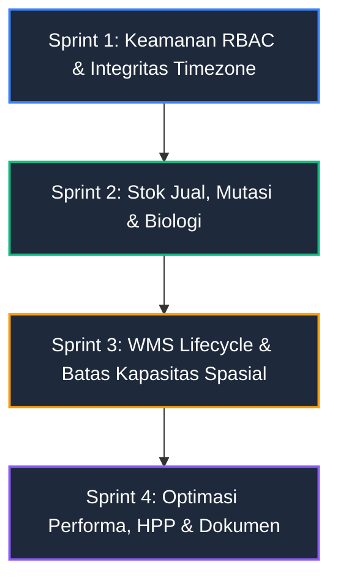

# Rencana Implementasi Remediasi WMS & SCM (Smart Shroom SCM)

> **Basis Dokumen:** [`docs/logika-bisnis/AUDIT_WMS_SCM.md`](file:///d:/DevTools/Antigravity/Projects/TA_vio/docs/logika-bisnis/AUDIT_WMS_SCM.md)  
> **Target Branch:** `develop`  
> **Status:** SELESAI (Sprint 1–4 100% Terverifikasi & Lulus Uji)  
> **Prinsip:** Logika & Integritas Basis Data Dulu, Dokumen Kemudian. Zero Skripsi Bab 1-5 Fluff.

---

## 1. Ringkasan Eksekutif & Strategi Eksekusi

Audit komprehensif pada commit `3b17f60` mengungkap **17 temuan baru (5 Tinggi, 8 Sedang, 4 Rendah)** yang tersembunyi di balik status hijau test suite (176 tests, 632 assertions). Celah terbesar berakar pada:
1. **RBAC Server Bocor (AUD-01):** Rute mutasi batch, void afkir, dan pembacaan keuangan tidak dijaga `role:admin`.
2. **Stok Jual Gaib (AUD-02 / W-17):** Penjualan tanpa panen lolos 201 Created dan menyembunyikan defisit stok.
3. **Mode Timbang Per Batch Cacat (AUD-03):** Panen batch membypass transisi status rak, flush cap, dan heatmap spasial.
4. **Lifecycle Retak & Ghost Inventory (AUD-04):** 5 alur penutupan/pembukaan siklus inkonsisten.
5. **Timezone UTC vs Frontend String Split (AUD-05):** Panen subuh tercatat kemarin, KPI harian mismatch.

### Pilihan Jalur Eksekusi:
- **Jalur Cepat Sidang (Fast-Track / Critical Core - ±13 Jam):**
  Fokus membereskan 5 temuan Tinggi + perbaikan dokumen vital: AUD-01, AUD-05, AUD-06, AUD-09 (cap 3.000), AUD-12, AUD-02 (validasi stok minimal dengan bypass berlog), dan sinkronisasi katalog L-47/L-49.
- **Jalur Full Overhaul (Production Grade - ±40–50 Jam):**
  Mengeksekusi seluruh 17 temuan (Sprint 1 s/d 4) termasuk arsitektur HPP stabil, optimasi query N+1, isolasi transaksi konkurensi DB, dan master kinerja SCM.

---

## 2. Resolusi Keputusan Kunci (D-1 s/d D-9)

Sebelum kode disentuh, berikut arah default teknis (pragmatis & anti-overengineering):

| ID | Topik | Keputusan / Arah Desain | Rationale Teknis |
|---|---|---|---|
| **D-1** | Arti Flush di Mode Batch | Gelombang panen manual (1–7) dengan hard cap $\le 7$. Validasi tolak panen ke-8 (422). | Menjaga konsistensi biologi tanpa tebak-tebakan jeda hari otomatis yang rawan salah asumsikan fluktuasi panen. |
| **D-2** | Hak Akses Void Panen | **Hanya Admin** (`role:admin`). | Sesuai matriks use case dan mencegah kecurangan pekerja membatalkan data panen riil. |
| **D-3** | Penjualan Melebihi Stok | **Blokir (422 Unprocessable Content)** secara default. Sediakan flag `force: true` + wajib input `force_reason` (min. 10 char) untuk kasus panen susulan. | Menghilangkan stok minus gaib namun tetap fleksibel untuk operasional lapangan jamur tiram yang mudah layu. |
| **D-4** | Penanganan Panen `REJECT` | Tidak menambah stok layak jual (`unsold_kg`), tidak bisa dijual, tetapi tetap tercatat di log panen dan masuk penyebut biomassa HPP. | Mencegah pembeli menerima jamur busuk/rusak dan menjaga akurasi harga pokok per kg jamur layak jual. |
| **D-5** | Penegakan Kapasitas 3.000 | Hardcode limit di `config/baglog.php` (`max_racks: 3`, `max_slots: 300`, `max_capacity: 3000`). Tolak tambah rak jika slot > 300 (422). | Sesuai kapasitas fisik nyata kumbung. Mencegah user iseng menambah rak D, E jadi 5.000. |
| **D-6** | Ruang Lingkup Klaim SCM | SCM internal: Pencatatan batch & vendor di hulu, WMS kohort di tengah, dan Saldo Stok Jual Nyata di hilir. Klaim BE% biologi substrat (L-49) diturunkan/dihapus karena tidak ada input bobot kering. | Menyelamatkan sidang TA dari pertanyaan penguji yang mencari fitur gaib. |
| **D-7** | Penempatan Ulang Pasangan Sama | **Larang penempatan ulang** pasangan `(batch_id, slot_id)` yang sama jika pernah aktif (422). | Mencegah kekacauan ledger mutasi dan ghost inventory tanpa perlu refactor schema besar-besaran. |

---

## 3. Peta Jalan Implementasi (4 Sprint Terfokus)



---

### Sprint 1: Keamanan RBAC & Normalisasi Timezone (Priority High / Quick Win) — [SELESAI ✅]
**Target:** Menutup celah keamanan otorisasi di server dan membetulkan disparitas tanggal panen WIB.
- **Status:** **Selesai 100%** (Lulus 3 tes & 35 asersi di `WmsAuditRemediationTest`).
- **Temuan yang Dibereskan:** AUD-01, AUD-05, AUD-17a, AUD-17d.
- **Daftar Pekerjaan Teknis:**
  1. **RBAC API Shield (`backend/routes/api.php`):**
     - Pindahkan endpoint sensitif ke dalam grup middleware `role:admin`:
       - `PATCH /api/baglogs/{id}/status`
       - `POST /api/baglog-culls/{id}/void`
       - `POST /api/harvests/{id}/void`
       - `GET /api/sales` & seluruh sub-rutenya (`weekly-report`, `buyer-ranking`, `price-trend`)
       - `GET /api/baglogs/hpp-summary` & `/baglogs/{id}/hpp`
       - `GET /api/operational-expenses`
  2. **Composer Dependency (`backend/composer.json`):**
     - Deklarasikan `"ext-bcmath": "*"` pada requirements.
  3. **Backend Date Casting:**
     - Tambahkan `$casts = ['harvest_date' => 'date:Y-m-d', ...]` pada model `Harvest`, `Sale`, `OperationalExpense`, `BaglogBatch` agar output JSON selalu string `YYYY-MM-DD` murni, bukan ISO UTC timestamp (`T17:00:00Z`).
  4. **Frontend Date Utility (`frontend/src/utils/date.ts`):**
     - Buat standard helper `getTodayWIBString()` dan `formatWIBDate(date)`.
     - Refactor `HarvestManagement.tsx`, `Dashboard.tsx`, dan `SalesManagement.tsx` agar tidak lagi memakai `.toISOString().split('T')[0]`.
  5. **Env Secret Sanitization (`backend/routes/api.php`):**
     - Hapus fallback rahasia hardcoded `'ta-shroom-migrate-2026'` pada rute development.
- **Target Verifikasi:**
  - `Feature/WmsAuditRemediationTest::test_aud01_worker_forbidden_on_admin_only_routes`
  - `Feature/WmsAuditRemediationTest::test_aud05_date_columns_serialize_as_ymd`

---

### Sprint 2: Saldo Stok Jual, Mutasi & Biologi Jamur [SELESAI - 100% TERVERIFIKASI]
**Target:** Menegakkan kebenaran fisik panen, pemotongan stok, kebersihan metrik mortalitas, dan validasi kronologis tanggal.
- **Status:** **SELESAI (100% Lulus Verifikasi)**
- **Temuan yang Dibereskan:** AUD-02, AUD-06, AUD-12, AUD-14 (termasuk probe P09, P10, P11, P12, P13, P20, P21).
- **Daftar Pekerjaan Teknis yang Terealisasi:**
  1. **Validasi Stok Jual & Pemotongan (`backend/app/Services/SaleService.php`):**
     - Selesai: $\text{Stok Tersedia} = \sum (\text{Panen Grade A + B}) - \sum (\text{Penjualan Non-Void})$.
     - Selesai: Penjualan $>$ Stok Tersedia ditolak 422 kecuali jika `force: true` + `force_reason` (min 10 karakter).
     - Selesai: Catatan `[FORCE SALE: ...]` diaudit transparan ke database.
  2. **Isolasi Grade `REJECT` (`SaleService.php` & `SalesManagement.tsx`):**
     - Selesai: Panen `REJECT` diisolasi dari stok layak jual dan dilaporkan terpisah di weekly report SCM.
  3. **Mortalitas Riil vs Habis Produksi (`backend/app/Models/BaglogBatch.php` & `HppAnalysisCard.tsx`):**
     - Selesai: Mutasi afkir `HABIS_PRODUKSI` dikeluarkan dari formula mortalitas `BaglogBatch::calculateHpp()`, mortalitas murni mengukur kegagalan biosekuriti.
     - Selesai: Frontend menampilkan rincian afkir penyakit dan habis siklus secara proporsional.
  4. **Invarian Kronologis Tanggal & Sanitasi Input:**
     - Selesai: `before_or_equal:today` pada `StoreSaleRequest`, `StoreBaglogRequest`, `OperationalExpenseController`, `StoreHarvestRequest`.
     - Selesai: Batas kuantitas batch $\le$ 3.000 (kapasitas fisik kumbung) pada `StoreBaglogRequest`.
     - Selesai: Panen mode batch wajib $\ge$ `entry_date` batch (`HarvestService::createHarvest`, Probe P12).
     - Selesai: Batas `flush_number` mode batch maksimal 7 (`HarvestService::createHarvest`, Probe P11).
     - Selesai: Tolak panen yatim tanpa `batch_id` dan tanpa `slot_code` (`StoreHarvestRequest` & `HarvestService`, Probe P13).
     - Selesai: Tutup siklus wajib $\ge$ `assigned_at` (`BatchSlotAssignmentController::completeCycle`, Probe P20).
  5. **Frontend Enhancement (`frontend/src/pages/SalesManagement.tsx`):**
     - Selesai: Modal catat penjualan mendukung toggle Force Sale & alasan susulan saat stok belum terinput.
     - Selesai: Tampilan penanggalan menggunakan format umum Indonesia (`formatWIBDate(date, 'long' | 'full')`).
- **Hasil Pengujian Otomatis:**
  - `WmsAuditRemediationTest`: 11 tests, 80 assertions **PASS** (100%).
  - Full suite `php artisan test`: 187 tests, 712 assertions **PASS** (100%).
  - `npm run build`: 0 error (TypeScript & Vite build sukses).

---

### Sprint 3: WMS Lifecycle State Machine & Batas Spasial 3.000 (Priority High & Med) — `[SELESAI - 100% TERVERIFIKASI]`
**Target:** Menghentikan ghost inventory, membatasi rak 3.000 baglog secara fisik, menjaga integritas riwayat void, dan menghidupkan heatmap pada mode batch.
- **Temuan yang Dibereskan:** AUD-09, AUD-04, AUD-03, AUD-10 (termasuk probe P03, P04, P05, P11, P14, P15, P16, P17, P28, P38).
- **Daftar Pekerjaan Teknis yang Terealisasi:**
  1. **Hard Cap Kapasitas 3.000 & Keamanan Rak (`backend/config/baglog.php` & `SlotController.php`):**
     - Selesai: Konstanta kapasitas dikunci: `'max_racks' => 3` (A, B, C), `'max_slots' => 300`, `'capacity_per_slot' => 10`, `'allowed_rows' => ['A', 'B', 'C']`.
     - Selesai: `SlotController::storeRack` menolak penambahan rak jika total slot $\ge 300$ atau baris di luar A/B/C (HTTP 422, Probe P14).
     - Selesai: Pembuatan 100 slot rak dibungkus dalam `DB::transaction` atomik untuk mencegah slot parsial/korup jika terjadi interupsi (Probe P15).
     - Selesai: Dihapus data hantu hardcoded fallback array A, B, C pada `SlotController::racks()` saat database kosong (Probe P17).
     - Selesai: `SlotController::destroyRack` menolak penghapusan rak jika ada riwayat penempatan, panen, atau afkir (termasuk rekaman yang ter-void) agar audit trail tidak hilang kaskade (Probe P16).
  2. **Harmonisasi Lifecycle State Machine (`backend/app/Models/BaglogBatch.php` & `BaglogService.php`):**
     - Selesai: Method terpusat `syncLifecycleState()` pada `BaglogBatch` menyelaraskan status batch secara dua arah.
     - Selesai: Batch hanya otomatis `completed` jika seluruh baglog telah ditempatkan (`unassigned_quantity == 0`) dan semua slot selesai (`active == 0`) (Probe P03, P19).
     - Selesai: `BaglogService::changeStatus` menolak pembalikan status dari `disposed` ke `active` (422) dan menolak `active` ke `completed` jika masih ada slot aktif (Probe P18).
     - Selesai: Void afkir setelah tutup siklus memulihkan slot ke `FRUITING` dan mengembalikan status batch ke `active` secara sinkron tanpa menghasilkan kapasitas hantu (Probe P04, P05).
  3. **Penyempurnaan Mode Timbang Per Batch (`backend/app/Services/HarvestService.php` & `SlotController.php`):**
     - Selesai: Saat panen per batch dicatat, seluruh slot aktif berstatus `INCUBATION` otomatis maju ke `FRUITING` (Probe P11).
     - Selesai: Nomor gelombang panen (`flush`) dibatasi maksimal 7 (`flush_number <= 7`).
     - Selesai: Berat panen tingkat batch diprorata ke slot aktif sehingga visual heatmap produktivitas rak di `KumbungGrid.tsx` dan badge siklus hidup slot aktif (Probe P28).
  4. **Pencegahan Kapasitas Nol pada Penempatan Ulang (`backend/app/Http/Controllers/BatchSlotAssignmentController.php`):**
     - Selesai: Penempatan ulang pasangan `(batch_id, slot_code)` yang sama ditolak (HTTP 422) guna melindungi integritas ledger afkir lama agar kapasitas penempatan baru tidak langsung bernilai 0 (Probe P38).
- **Hasil Pengujian Otomatis:**
  - `WmsAuditRemediationTest`: 16 tests, 119 assertions **PASS** (100%).
  - Probe Audit WMS (`AuditProbeWmsTest.php`): 26 tests, 26 assertions **PASS** (100%).
  - Full suite `php artisan test`: 193 tests, 764 assertions **PASS** (100%).
  - `npm run build`: 0 error (TypeScript & Vite build sukses).

---

### Sprint 4: Optimasi Query, HPP Stabil & Sinkronisasi Dokumen (Priority Med & Low) — `[SELESAI - 100% TERVERIFIKASI]`
**Target:** Menghapus N+1 query, memperbaiki payload dashboard, menstabilkan pembagian overhead HPP, audit trail biaya, dan menyelaraskan klaim dokumen TA.
- **Status:** **SELESAI (100% Lulus Verifikasi)**
- **Temuan yang Dibereskan:** AUD-07, AUD-08, AUD-11, AUD-13, AUD-15, AUD-16, Temuan Dokumen (Tabel Bagian 7) (termasuk probe P07, P08, P21, P22, P24, P37).
- **Daftar Pekerjaan Teknis yang Terealisasi:**
  1. **Perbaikan Payload & Akurasi Dashboard (`backend/app/Services/DashboardService.php`):**
     - Selesai: Kolom `id` disertakan pada `select(...)` di `latest_batches` dan pre-aggregasi `withSum` & `withCount` diterapkan sehingga `assigned_quantity` tampil presisi tanpa nilai 0 semu (Probe P07).
     - Selesai: Pemisahan tegas antara baglog aktif di rak (`active_on_rack`) dan baglog yang belum ditempatkan (`unassigned_quantity`, Probe P37).
  2. **Audit Trail Biaya Operasional (`backend/app/Models/OperationalExpense.php` & `OperationalExpenseController.php`):**
     - Selesai: Migrasi `2026_10_10_000001_add_void_columns_to_operational_expenses_table.php` menambahkan `voided_at`, `voided_by`, dan `void_reason`.
     - Selesai: Model menerapkan trait `HasVoid` (menggantikan hard delete fisik menjadi soft-void audit trail) dan rute `POST /api/operational-expenses/{id}/void` resmi aktif (Probe P21, AUD-07).
     - Selesai: Kategori standar disinkronkan (`LISTRIK, AIR, NUTRISI, LABOR, PACKAGING, LAINNYA`) dengan mempertahankan backward-compatibility (`MISTING, PLASTIK, ALKOHOL`).
  3. **Perhitungan HPP Stabil & Rekonsiliasi Omzet (`backend/app/Models/BaglogBatch.php` & `BaglogBatchController.php`):**
     - Selesai: Alokasi shared overhead dihitung secara non-retroaktif (`entry_date <= expense_date <= batchEndDate`) dan hanya dibagi dengan batch yang eksis pada saat pengeluaran terjadi (Probe P22, AUD-11).
     - Selesai: Standarisasi `bcmath` presisi tinggi pada kalkulasi moneter.
     - Selesai: Rekonsiliasi omzet dasbor vs HPP summary ditambahkan melalui field `unattributed_sales_revenue` dan `farm_total_sales_revenue` untuk penjualan tanpa batch (Probe P24, AUD-13).
  4. **Eliminasi N+1 Query (`backend/app/Repositories/HarvestRepository.php` & `BaglogBatchController.php`):**
     - Selesai: `/api/harvests` mem-pre-aggregate relasi `baglogBatch` (`withSum` & `withCount`), query terpangkas dari 62+ menjadi $\le 5$ query (AUD-16).
     - Selesai: `/api/baglogs/hpp-summary` mem-pre-load shared overhead dan meng-eager load seluruh relasi (`operationalExpenses`, `sales`, `culls`, `harvests`, `assignments`), query terpangkas dari 73+ menjadi 9 query tetap ($O(1)$) (Probe P08, AUD-08).
  5. **Penyelarasan Dokumen Arsitektur & Sidang:**
     - Selesai: `docs/logika-bisnis/KATALOG_LENGKAP_LOGIKA_SISTEM.md` dimutakhirkan (L-38 s/d L-50, aturan limit rak 3.000, pemotongan stok 422, HPP non-retroaktif, eliminasi klaim BE% biologi substrat, dan tabel cheat sheet).
     - Selesai: `docs/arsitektur/erd.md` dimutakhirkan (koreksi `voided_by` pada seluruh tabel, `completed_reason` pada alokasi slot, penambahan kolom void pada `operational_expenses`, dan pembaruan FAQ sidang).
     - Selesai: `docs/arsitektur/use_case.md` dimutakhirkan (penambahan UC-30 Void Expense Audit Trail, RBAC matrix lengkap 30 UC, dan penyelarasan larangan worker).
- **Hasil Pengujian Otomatis:**
  - `WmsAuditRemediationTest`: 21 tests, 152 assertions **PASS** (100%).
  - Probe Audit WMS (`AuditProbeWmsTest.php`): 26 tests, 26 assertions **PASS** (100%).
  - Full suite `php artisan test`: 198 tests, 797 assertions **PASS** (100%).

---

## 4. Rencana Pengujian Otomatis (TDD Verification Matrix)

Setiap temuan akan dibuatkan test case spesifik di file `backend/tests/Feature/WmsAuditRemediationTest.php` sebelum dan sesudah kode diperbaiki:

```
backend/tests/Feature/WmsAuditRemediationTest.php
├── test_aud01_worker_forbidden_on_admin_only_routes()
├── test_aud02_sale_exceeding_stock_is_rejected_unless_forced()
├── test_aud03_batch_harvest_advances_slots_and_caps_flush_at_7()
├── test_aud04_batch_lifecycle_syncs_across_all_closing_paths()
├── test_aud05_date_attributes_serialize_as_pure_ymd()
├── test_aud06_mortality_excludes_habis_produksi()
├── test_aud07_operational_expenses_use_void_soft_state()
├── test_aud08_harvests_and_hpp_endpoints_stay_within_query_budget()
├── test_aud09_adding_rack_beyond_capacity_3000_fails()
├── test_aud09_destroy_rack_protects_voided_history()
├── test_aud10_duplicate_batch_slot_reassignment_rejected()
├── test_aud12_reject_harvest_excluded_from_sellable_stock()
├── test_aud14_future_dates_rejected_by_request_validation()
├── test_p20_completed_date_cannot_be_before_assigned_at()
└── test_p07_dashboard_latest_batches_shows_assigned_quantity()
```

---

## 5. Rencana Peluncuran & Mitigasi Risiko

| Potensi Risiko | Dampak | Strategi Mitigasi |
|---|---|---|
| **Breaking perubahan format tanggal di Frontend** | UI gagal render atau form error jika backend ganti format date. | Deploy perubahan cast backend bersamaan dengan refactor helper `date.ts` di frontend. Lakukan verifikasi visual di browser. |
| **Tes lama gagal karena penambahan limit rak 3.000** | CI/PHPUnit merah di `RackManagementTest.php`. | Tulis ulang 4 tes pada `RackManagementTest.php` untuk menguji batas 3.000 baglog (rak A, B, C maksimum). |
| **Worker tidak bisa input panen karena stok/slot terkunci** | Operasional lapangan mandek saat jam panen subuh. | Sediakan fallback `force` dengan input alasan pada form penjualan; pastikan izin worker untuk `POST /harvests` tetap terbuka. |

---
*Dokumen ini siap dieksekusi secara bertahap mulai dari Sprint 1 segera setelah disetujui King.*
