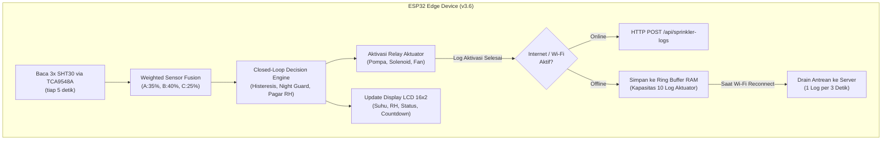

# Panduan Hardware & Master Belanja IoT (Smart Shroom SCM)

| Atribut | Keterangan |
|---|---|
| Proyek | Smart Shroom SCM (Kumbung Jamur Kuping 7 × 5 × 3 m / ±122,5 m³ tanpa plafon) |
| Status Dokumen | **Single Source of Truth (As-Built & Final Audit)** |
| Basis Firmware | `esp32_firmware/esp32_firmware.ino` (v3.6) |
| Diverifikasi terhadap | `docs/teknis-iot/rancangan_hardware_kumbung.md`, `docs/arsitektur/iot-architecture.md`, dan audit belanja final |
| Lingkup | Komponen elektronika IoT, aktuasi misting, filtrasi, exhaust fan, proteksi kelistrikan |

---

## 1. Master Checklist Belanja Hardware IoT

> 📌 **Catatan Pengadaan:**
> Daftar ini adalah **Daftar Belanja Tunggal Terverifikasi**. Seluruh kesalahan hitung matematis pada draf awal telah dikoreksi (penghematan Rp 95.000), 10 item instalasi esensial (T1–T10) telah diintegrasikan, dan komponen bloat/fiktif yang tidak dipakai firmware (RTC, MQ-135, BH1750, SPIFFS) telah dieliminasi total.

---

### 📋 Tabel Master Komponen & Perintilan Siap Checkout

| No | Kategori | Komponen / Item | Spesifikasi Wajib & Rekomendasi | Qty | Estimasi Harga | Fungsi & Catatan Perakitan Lapangan |
| :-: | :--- | :--- | :--- | :-: | :-: | :--- |
| **A** | **PEMROSESAN & KENDALI** | | | | | |
| 1 | Processing | **ESP32 DevKit V1** | 30-Pin, Wi-Fi + BLE, Dual Core (ESP32-WROOM-32) | 1 Unit | Rp 65.000 | Otak edge compute & histeresis closed-loop. Hindari varian S2/S3/C3 karena beda peta pin. |
| 2 | Expansion | **ESP32 Terminal Shield Expansion Board** | Khusus ESP32 30-Pin dengan Screw Terminal | 1 Unit | Rp 30.000 | **Wajib.** Mengubah pin ESP32 jadi terminal baut agar kabel sensor & relay terkunci kokoh anti-goyang. |
| 3 | I2C Hub | **Modul I2C Multiplexer TCA9548A** | 8-Channel I2C Switch, Default Addr `0x70` | 1 Unit | Rp 18.000 | **Wajib.** Memecah jalur I2C agar 3 sensor SHT30 dengan alamat sama (`0x44`) dibaca bergantian tanpa collision. |
| 4 | Aktuator Driver | **Modul Relay 4-Channel 5V Optocoupler** | 5V Coil, Low-Level Trigger, Jumper JD-VCC | 1 Unit | Rp 35.000 | Saklar pompa 12V (CH1), solenoid 12V (CH2), fan 220V (CH3). *(Lepas jumper JD-VCC: VCC=3.3V ESP32, JD-VCC=5V LM2596)*. |
| T1 | Display Lokal | **LCD 16×2 I2C (PCF8574, Addr 0x27)** | Modul Backpack I2C 1602 LCD Biru/Kuning | 1 Unit | Rp 30.000 | **Wajib.** Dipakai aktif oleh firmware untuk monitor IP Wi-Fi, suhu/RH 3-zona, status aktuator, dan hitung mundur mode panen. *(Cabut 2 resistor pull-up 5V di backpack atau gunakan level shifter)*. |
| **B** | **SENSING & MONITORING** | | | | | |
| 5 | Sensing | **Sensor SHT30 / SHT31 Probe IP68 Waterproof** | Varian **I2C (4-Kabel)**, Casing Logam Kisi-Kisi | **3 Unit** | Rp 285.000 *(3x @95rb)* | Pengukur Suhu & RH presisi untuk 3 zona (Atas 2.5m, Tengah 1.5m, Bawah 0.5m) mendukung *Weighted Sensor Fusion*. |
| **C** | **AKTUATOR, MISTING & PLUMBING** | | | | | |
| 6 | Aktuator | **Pompa Diafragma High Pressure DC 12V** | 130–160 PSI (Otomatis Cut-Off / Pressure Switch) | 1 Unit | Rp 135.000 | Pendorong air kabut tekanan tinggi untuk 14 titik misting (arus kerja 4–6A). |
| 7 | Aktuator | **Solenoid Valve Air 12V DC Drat 1/2"** | **Material Kuningan (Brass)**, Tipe NC, Rating ≥ 10 Bar | 1 Unit | Rp 110.000 | Pemutus aliran seketika (*anti-drip* agar nozzle tidak menetes saat pompa mati). Wajib kuningan tahan 130 PSI. |
| 8 | Aktuator | **Exhaust Fan Sirkulasi 10 Inch AC 220V** | Fan Dinding / Ventilasi Plafon, Kabel 3-Wire (L, N, PE) | 1 Unit | Rp 160.000 | Membuang udara panas plafon, pendinginan siang, & sirkulasi udara segar. Wajib arde bodi (PE). |
| 9 | Misting | **Misting Nozzle Brass 0.3mm + Tee Slip Lock 6mm** | Lubang Nozzle Kuningan 0.3mm + Fitting Tee Quick Push-In 6mm | **16 Set** *(14 pasang + 2 cadangan)* | Rp 192.000 *(16x @12rb)* | Memecah air jadi kabut mikro di langit-langit (2 baris × 7 nozzle). |
| 10 | Misting | **Selang PU (Polyurethane) High Pressure 6mm** | Diameter Luar 6mm, Tekanan Kerja ≥ 10–12 Bar | 25 Meter | Rp 125.000 | Distribusi air bertekanan tinggi dari solenoid ke seluruh baris nozzle. |
| 11 | Filtrasi | **Housing Filter 10" + Cartridge Spun 5 µm** | Drat Inlet/Outlet 1/2" + Spun PP **5 Mikron** | 1 Set (+ 2 Cartridge Cadangan) | Rp 115.000 | **PENTING:** Gunakan cartridge **5 µm** (bukan 1 µm) agar pompa diafragma tidak kavitasi dan ngos-ngosan. Nozzle 0.3mm = 300 µm, sehingga 5 µm sangat aman dari sumbatan. |
| T2 | Kalibrasi | **Manometer 0–200 PSI (Ulir 1/4") + Adaptor 6mm** | Dial Oil/Dry Gauge 0–14 Bar | 1 Unit | Rp 65.000 | Untuk menyetel baut pressure switch pompa agar tekanan kerja tidak melampaui rating solenoid & fitting (<10 bar). |
| T3 | Konektor Air | **Nepel Selang (Hose Barb) 1/2" Kuningan** | Drat 1/2" Male to Selang 1/2" | 3 Pcs | Rp 30.000 | Menghubungkan selang isap spiral 1/2" dari tandon ke inlet/outlet filter dan inlet pompa. |
| **D** | **ELEKTRIKAL & CATU DAYA** | | | | | |
| 12 | Power Supply | **SMPS 12V 10A DC Metal Enclosure** | Input 220V AC, Output 12V DC 120 Watt Regulasi | 1 Unit | Rp 110.000 | Sumber daya utama pompa (puncak 6A), solenoid (0,8A), dan step-down logika. |
| 13 | Step Down | **Modul Buck Converter LM2596 DC-DC** | Input 12V, Output Adjustable (Set ke 5.0V Presisi) | 2 Unit *(1 utama + 1 cadangan)* | Rp 30.000 | Menurunkan 12V jadi 5.0V bersih untuk ESP32 VIN dan koil relay. Setel 5.0V dengan multimeter sebelum disambung! |
| 14 | Enclosure | **Box Panel Waterproof IP65 Outdoor** | Plastik ABS Tebal (Min. 300 × 200 × 130 mm) | 1 Unit | Rp 95.000 | Rumah seluruh kontroler, tahan lembap RH 90%. Plastik ABS agar sinyal Wi-Fi ESP32 tembus leluasa. |
| T4 | Dudukan | **Rel DIN 35 mm (Panjang ±20 cm) + Sekrup** | Plat Rel DIN Standar MCB/RCBO | 1 Batang | Rp 15.000 | Dudukan kokoh untuk RCBO dan terminal busbar di dalam box IP65. |
| T5 | Proteksi Utama | **RCBO 1P+N 30 mA (Arus Pengenal 4–6 A)** | Proteksi Arus Lebih + Kebocoran Arus Bumi (ELCB) | 1 Unit | Rp 180.000 | **Sangat Disarankan (Pengganti MCB 2A).** Melindungi pekerja dari sengatan listrik fatal di kumbung lembap RH 90% dan mencegah jeglek akibat arus inrush SMPS. |
| 15 | Jaringan | **Wi-Fi Range Extender 300 Mbps** | Colokan PLN, Frekuensi 2.4 GHz | 1 Unit | Rp 140.000 | **Opsional (Tunda Beli).** Ukur RSSI Wi-Fi di titik box panel terlebih dahulu; beli hanya jika sinyal di bawah -75 dBm. |
| **E** | **PERINTILAN KABEL & KONEKTOR ELEKTRONIK** | | | | | |
| 16 | Kabel Sinyal | **Kabel FTP Cat5e Twisted-Pair (Shielded)** | 4-Pair AWG24 Tembaga Murni (Foil + Drain Wire) | 25 Meter | Rp 100.000 | Jalur data I2C 3 sensor SHT30. Kebutuhan 21,83 m (beli 25 m sisa 3,17 m, atau 30 m sisa 8,17 m lebih aman). Wajib FTP berpelindung aluminium foil untuk meredam noise I2C jarak sampai 9,6 meter. |
| 17 | Kabel Jumper | **Kabel Jumper Dupont Female-to-Female (20 cm)** | 1 Ribbon (Isi 40 Pin) | 1 Set | Rp 15.000 | Menghubungkan TCA9548A, LCD, dan modul kendali. Ujung terminal sekrup diberi ferrule. |
| 18 | Kabel Jumper | **Kabel Jumper Dupont Male-to-Female (20 cm)** | 1 Ribbon (Isi 40 Pin) | 1 Set | Rp 15.000 | **Boleh dilewati (Hemat Rp 15.000)** karena shield memakai terminal sekrup. |
| 19 | Kabel Daya DC | **Kabel Serabut 2 × 1.5 mm² (Merah-Hitam)** | Tembaga lentur untuk beban arus 12V DC | 6 Meter | Rp 50.000 | Jalur daya 12V dari SMPS/Relay ke Pompa Diafragma dan Solenoid Valve. |
| 20 | Kabel Daya AC | **Kabel Listrik NYYHY / NYM 3 × 1.5 mm²** | 3-Core (Fase Cokelat, Netral Biru, Ground Hijau-Kuning) | 10 Meter | Rp 90.000 | Jalur 220V dari RCBO/Relay ke Exhaust Fan (Wajib arde PE ke bodi fan). |
| T7 | Kabel PLN | **Steker 3-Pin Berarde + Kabel Power AC 1.5 m** | Steker Arde Standar SNI 16A | 1 Set | Rp 20.000 | Kabel input utama 220V AC dari stopkontak luar ke RCBO di dalam box. |
| 21 | Konduit | **Pipa Konduit Listrik PVC Ø 20 mm + Klem + Elbow** | Pipa pelindung kabel outdoor | 4–5 Batang | Rp 70.000 | Pisahkan 2 jalur pipa terpisah: satu untuk sinyal sensor (DC), satu untuk daya 220V AC. |
| 22 | Cable Gland | **Cable Gland Waterproof PG9 / PG11** | Ulir drat + seal karet kedap air | 8 Pcs | Rp 40.000 | Masuknya kabel sensor Cat5e (PG9) ke bagian bawah box IP65. |
| T9 | Cable Gland | **Cable Gland Waterproof PG13.5** | Diameter kabel 9–12 mm | 2 Pcs | Rp 10.000 | Untuk jalur kabel 220V AC (NYYHY 3×1.5 mm²) yang lebih tebal. |
| 23 | Terminal & Skun | **Terminal Blok Busbar / WAGO + Ferrule Bootlace** | Set skun jarum serabut kabel + konektor sambungan | 1 Set | Rp 65.000 | Mengunci serabut kabel tembaga agar tidak mbrudul/short di screw terminal. |
| **F** | **PERINTILAN PLUMBING & ADAPTOR NOZZLE** | | | | | |
| 24 | Adaptor Solenoid | **Fitting Adaptor Drat Luar 1/2" Male ke Quick 6mm** | Kuningan / Pneumatic Drat 1/2" to 6mm Tube | 2 Pcs | Rp 30.000 | Menyambungkan selang PU 6mm ke inlet dan outlet solenoid valve 1/2". |
| 25 | Adaptor Pompa | **Fitting Nepel Pompa Diafragma ke Quick 6mm** | Ulir drat outlet pompa (18mm / 1/2") to 6mm Tube | 2 Pcs | Rp 30.000 | Menyambungkan outlet pompa diafragma ke selang PU 6mm. |
| 26 | Selang Isap | **Selang Spiral Kawat Anyaman Transparan 1/2"** | Diameter dalam 1/2", kawat baja anti-kempot | 1.5 Meter + 4 Klem | Rp 35.000 | Jalur hisap air dari Tandon → Housing Filter Sedimen → Inlet Pompa. |
| 27 | Splitter Misting | **Fitting Tee 6mm Polos + End Plug 6mm** | Quick Fitting Slip-Lock 6mm | 3 Pcs Tee + 4 Pcs Plug + 1 Pcs Siku | Rp 35.000 | Fitting Tee polos untuk trunk & cabang 2 baris tengah (x 3,1 m); Plug untuk 4 ujung baris; Siku untuk belokan trunk. |
| 28 | Sealtape | **Seal Tape Kran Putih (Teflon Tape)** | Tebal rapat, panjang 10 meter | 2 Gulung | Rp 5.000 | Melapisi drat pompa, filter, dan solenoid agar 100% anti-rembes di tekanan 130 PSI. |
| 29 | Klip Gantung | **Klip Klem Selang 6mm / Cable Clamp R-Type** | Klem paku/sekrup selang PU ke bambu/kayu | 40 Pcs | Rp 20.000 | Menjaga selang PU tetap lurus dan tidak melendut di ketinggian 3 meter. |
| **G** | **KOMPONEN PROTEKSI ELEKTRONIK & COMMISSIONING** | | | | | |
| 30 | Pull-Up Resistor | **Resistor Metal Film 2.2 kΩ (1/4 Watt)** | Toleransi 1% | 10 Pcs | Rp 5.000 | Resistor pull-up jalur SDA dan SCL pada modul TCA9548A untuk kabel sensor panjang. |
| 31 | Dioda Flyback | **Dioda 1N5408 (3A) & 1N4007 (1A)** | Dioda penyearah silikon cepat | 2 Pcs Masing-Masing | Rp 5.000 | 1N5408 paralel terbalik di terminal pompa 12V; 1N4007 di solenoid (meredam ggl induksi koil). |
| 32 | Snubber Fan | **RC Snubber (0.1 µF 400V X2 + 100 Ω 2W)** | Peredam spark kontak relay AC 220V | 1 Unit | Rp 8.000 | Dipasang melintang di kontak relay fan agar ESP32 tidak restart saat kipas menyala/mati. |
| 33 | Kapasitor Filter | **Elco 1000 µF / 16V & Keramik 100 nF** | Kapasitor peredam ripple DC | 2 Pcs | Rp 5.000 | Elco di output LM2596 (5V) & keramik di terminal motor pompa DC. |
| 34 | Fuse DC | **Fuse Holder Inline Waterproof + Sekring Blade 10A** | Sekring otomotif 10A | 1 Set | Rp 15.000 | Proteksi beban lebih jalur DC 12V langsung setelah SMPS. |
| 35 | Isolasi Kabel | **Heat Shrink Tube Dual-Wall Berlem (4, 6, 8 mm)** | Selongsong bakar dengan lem perekat anti-air | 1 Set | Rp 20.000 | Melindungi sambungan kabel sensor SHT30 agar kedap air dan anti-oksidasi. |
| T8 | Isolasi Kabel | **Heat Shrink Tube Dual-Wall Berlem 12 mm** | Selongsong bakar diameter 12 mm | 1 Meter | Rp 8.000 | Menutup rapat sambungan jaket luar kabel FTP Cat5e (Ø 5–6 mm) ke probe sensor. |
| 36 | Cable Ties | **Kabel Ties Hitam UV Resistant + Karet Bantalan** | Panjang 20 cm & bantalan karet tebal | 1 Pak | Rp 25.000 | Mengikat pipa/kabel dan meredam getaran mekanis dudukan pompa diafragma. |
| T6 | Beban Uji | **Bohlam Pijar 15–25 W + Fitting Gantung** | Bohlam pijar 220V AC | 1 Set | Rp 15.000 | Beban uji aman untuk commissioning relay CH3 exhaust fan sebelum fan dipasang ke dinding. |
| T10 | Tandon Air | **Tandon Air Plastik 200–500 L + Pelampung Otomatis** | Tangki air bersih toren + radar pelampung | 1 Unit | *(Opsional)* | Diperlukan jika di kumbung belum tersedia tandon air bersih (konsumsi 50–100 L/hari). |

---

### 💰 Rekapitulasi Anggaran Belanja Final

| Kategori Pengeluaran | Estimasi Biaya |
| :--- | :--- |
| **Gelombang 1: Sensor & Uji Bangku (Item 1, 2, 3, 5, 16, 17, 30, 35, T1, T8)** | ± Rp 576.000 |
| **Gelombang 2: Kendali & Daya (Item 4, 12, 13, 14, 19, 20, 22, 23, 31, 32, 33, 34, 36, T4, T5, T6, T7, T9)** | ± Rp 871.000 |
| **Gelombang 3: Hidrolik & Misting (Item 6, 7, 8, 9, 10, 11, 21, 24, 25, 26, 27, 28, 29, T2, T3)** | ± Rp 1.277.000 |
| **TOTAL ESTIMASI KESELURUHAN (SIAP RAKIT LENGKAP)** | **± Rp 2.724.000** |

> 💡 **Peluang Penghematan Kas Lapangan:**
> 1. Menunda Wi-Fi Extender (Item 15) hemat **Rp 140.000**.
> 2. Melewati kabel jumper Dupont M-F (Item 18) hemat **Rp 15.000**.
> 3. Membeli box panel polosan tanpa MCB bawaan (karena sudah diganti RCBO T5) hemat **Rp 20.000 – Rp 30.000**.
> 4. Total belanja riil optimal: **± Rp 2.540.000**.

---

## 2. Arsitektur Ketahanan Edge (Edge Resilience & Fault-Tolerance)

Arsitektur IoT Smart Shroom SCM mengimplementasikan ketahanan komputasi di sisi tepi (*Edge Computing Resilience*) untuk menjawab tantangan riil pertanian: **"Bagaimana sistem beroperasi jika jaringan internet atau Wi-Fi kumbung mati total?"**

### 🧠 Cara Kerja Ketahanan Sistem (Firmware v3.6 As-Built)

Sistem **TIDAK MENGGUNAKAN** RTC eksternal (DS3231), sensor gas fiktif (MQ-135), maupun penyimpanan flash (SPIFFS/LittleFS) yang lambat dan cepat aus. Ketahanan sistem dibangun atas 4 pilar arsitektur ringan (*lean & deterministic*):

#### 1. Sinkronisasi Waktu via Network Time Protocol (NTP)
* Jam operasional firmware disinkronkan secara otomatis ke server waktu pool NTP (`pool.ntp.org`) saat pertama kali terhubung ke internet.
* **Fail-Safe Offline:** Jika koneksi internet putus sebelum NTP sinkron, fungsi pembaca jam mengembalikan nilai `-1`. Firmware secara otomatis mengaktifkan status `timeWarned` dan menonaktifkan aturan malam (*Night Guard*) demi keselamatan jamur, agar tidak terjadi penyemprotan salah waktu.

#### 2. Ring Buffer RAM untuk Log Aktuator (Zero Flash Wear)
* Riwayat aktivasi aktuator (waktu semprot pompa, durasi, trigger reason, stop reason) dicatat ke dalam antrean memori RAM berkapasitas 10 slot (`PendingLog logQ[10]`).
* Pemilihan RAM di atas SPIFFS/LittleFS mencegah masalah keausan flash memory (*flash wear out*) akibat penulisan berulang, serta menjaga latensi eksekusi tetap sub-milidetik.
* Begitu koneksi internet pulih, antrean log di-drain secara elegan (1 log per 3 detik) ke endpoint `/api/sprinkler-logs` tanpa membebani bandwidth.

#### 3. Non-Blocking Wi-Fi Reconnection Loop
* Jika koneksi Wi-Fi terputus, loop utama mikrokontroler **tidak pernah membeku (freeze)**.
* ESP32 mencoba reconnect setiap 15 detik secara asinkron (`lastWifiRetry`). Selama offline, seluruh mekanisme keselamatan lokal (Watchdog batas semprot 90s, interlock solenoid-pompa, proteksi histeresis suhu dan kelembapan) tetap berjalan 100% independen.

#### 4. Telemetri Status Lokal via LCD 16×2 I2C
* Operator di kumbung tidak bergantung pada aplikasi ponsel untuk mengetahui kondisi sistem. Layar LCD 16×2 di panel box secara bergantian menampilkan:
  * IP Address dan kekuatan sinyal Wi-Fi.
  * Suhu dan RH rata-rata tertimbang (*fused values*).
  * Status aktif pompa, solenoid, dan fan.
  * Hitung mundur mode jeda panen (*Harvest Pause countdown*).

---

## 3. Strategi Pengadaan Bertahap (3 Gelombang Uji)

Untuk mengeliminasi risiko kerugian pengadaan, pembelian wajib dilakukan dalam 3 gelombang bertahap dengan gerbang uji (*acceptance gate*) di setiap akhir gelombang:

### 🔹 Gelombang 1: Sensor & Uji Bangku I2C (Budget: ± Rp 576.000)
* **Item:** ESP32, Screw Terminal Shield, TCA9548A, 3× SHT30 IP68, Kabel FTP Cat5e (25 m), Resistor Pull-up 2.2 kΩ, LCD 16×2 I2C, Heat Shrink 12 mm.
* **Gerbang Uji 1:** Rangkai ketiga sensor di meja kerja menggunakan kabel FTP sepanjang ukuran final (±8 meter per sensor). Jalankan I2C pada clock 50 kHz. Pastikan data suhu dan kelembapan ketiga sensor terbaca stabil selama 2 jam tanpa satupun pembacaan `NaN`.

### 🔹 Gelombang 2: Kendali & Daya (Budget: ± Rp 871.000)
* **Item:** Modul Relay 4-Ch, SMPS 12V 10A, LM2596 (2 pcs), Box IP65, Kabel Daya DC/AC, RCBO 30 mA, Bohlam Pijar Uji (T6), Dioda Flyback (1N5408 & 1N4007), Snubber RC, Fuse 10A, Elco Filter.
* **Gerbang Uji 2:** 
  1. Setel output LM2596 tepat **5.00 V** menggunakan multimeter sebelum disambung ke ESP32.
  2. Uji isolasi relay (lepas jumper JD-VCC). Pastikan relay aktif saat GPIO LOW dan mati saat HIGH tanpa ada getaran kontak (*chattering*).
  3. Hubungkan relay CH3 ke bohlam pijar 220V (T6) dengan RC snubber terpasang. Simulasikan saklar on-off 20 kali; pastikan ESP32 tidak restart akibat lonjakan induksi.

### 🔹 Gelombang 3: Hidrolik & Misting (Budget: ± Rp 1.277.000)
* **Item:** Pompa Diafragma 12V 130–160 PSI, Solenoid Valve Kuningan 12V, Exhaust Fan 10", 16 Set Nozzle Brass 0.3mm + Tee Slip-Lock, Selang PU 6mm, Housing Filter Spun 5 µm, Manometer 0–200 PSI, Nepel Selang 1/2".
* **Gerbang Uji 3:**
  1. Rangkai jalur hidrolik: Tandon → Selang spiral 1/2" → Filter 5 µm → Solenoid → Pompa → Manometer → Selang PU 6mm → 14 Nozzle.
  2. Nyalakan pompa, amati jarum manometer: setel baut pressure switch agar tekanan kerja stabil di rentang **6–8 Bar (85–115 PSI)**.
  3. Uji kabut selama 90 detik: pastikan seluruh 14 nozzle mengabutkan air secara seragam tanpa tetesan kasar dan tanpa kebocoran di sambungan slip-lock.
